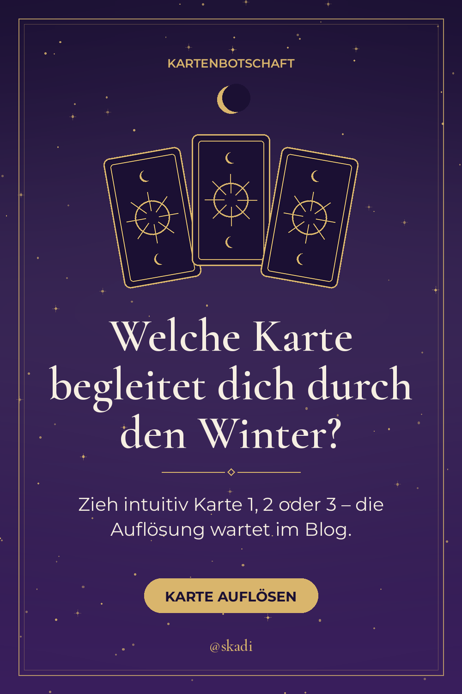
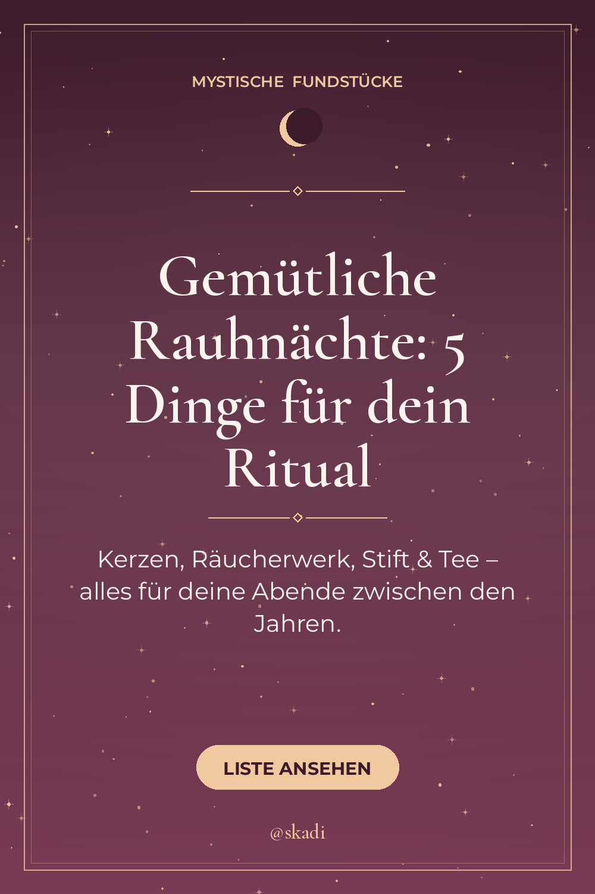
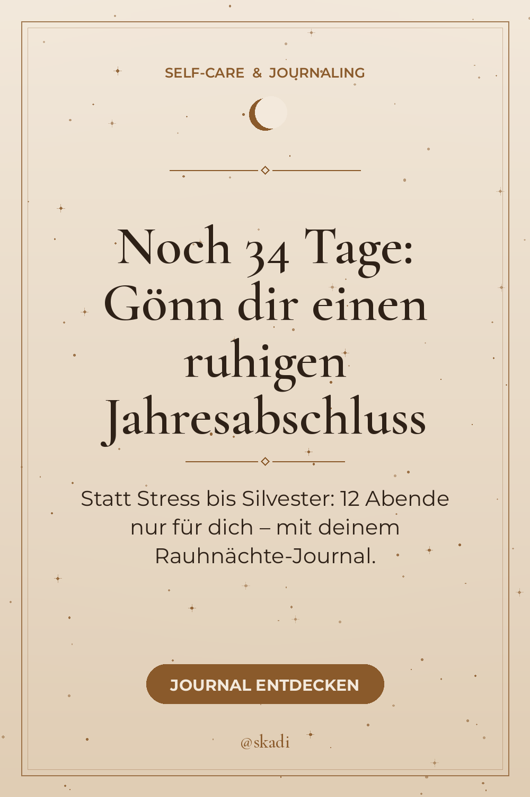

# Content-Plan 2026-11-21

## Trend-Grundlage

- Pinterest Hobbies Report 2026: 'energy cleansing ritual' +101 %, 'moon water ritual' +186 % – Ritual-Content wächst
- Kitchen-Witch-/Cozy-Ritual-Ästhetik (Pinterest Predicts 2026) – passt zu ruhigen Winterabenden und Rauhnächten
- Saisonal: Suchen nach 'Rauhnächte', '13 Wünsche' und 'Jahresrückblick' steigen ab Ende November; noch 34 Tage bis 25.12.
- TikTok/Reels: ruhige Schritt-für-Schritt-Rituale mit Text-Overlay und Ambient-Sound

## Pinterest – 5 Pins

Trage deinen Link in `plan.json` (Feld `link`) **oder** direkt in `pinterest_bulk.csv` ein.

### Pin 1 · 08:15 Uhr · Board: Spirituelle Downloads & PDFs

**Titel:** Rauhnächte Journal PDF zum Ausdrucken – 13 Wünsche & Journaling-Fragen

**Beschreibung:**

Begleite dich selbst liebevoll durch die 12 Rauhnächte vom 25. Dezember bis 6. Januar. Das Rauhnächte-Journal zum Ausdrucken enthält das 13-Wünsche-Ritual, Journaling-Fragen für jede Nacht, eine Räucher-Anleitung und einen Jahresrückblick. Für alle, die das Jahr bewusst abschließen und mit Klarheit ins neue starten möchten.

**Alt-Text:** Dunkelblaue Grafik mit Mond und Text: Rauhnächte-Journal – 12 Nächte für dein neues Jahr

**Link-Ziel:** pdf → `LINK EINFÜGEN` (Idee: Rauhnächte-Journal PDF)

### Pin 2 · 11:45 Uhr · Board: Tarot Karte des Tages

**Titel:** Tarot Pick a Card: Deine Botschaft für die Winterzeit

**Beschreibung:**

Atme kurz durch, wähle intuitiv Karte 1, 2 oder 3 und entdecke, welche Botschaft dich durch die dunkle Jahreszeit begleitet. Ein kleiner Moment der Selbstreflexion für deine Morgen- oder Abendroutine. Tarot Karte des Tages, Kartenlegen, Winter Ritual.

**Alt-Text:** Drei verdeckte Tarotkarten auf violettem Sternenhimmel mit Text: Welche Karte begleitet dich durch den Winter?

**Link-Ziel:** blog → `LINK EINFÜGEN` (Idee: Blogartikel mit Auflösung der 3 Karten)

### Pin 3 · 15:30 Uhr · Board: Rituale & Mondmagie

**Titel:** 13 Wünsche Ritual Rauhnächte – einfache Anleitung Schritt für Schritt

**Beschreibung:**

So funktioniert das 13-Wünsche-Ritual der Rauhnächte: Du schreibst 13 Herzenswünsche auf, verbrennst in jeder der 12 Nächte einen Zettel und der letzte Wunsch ist ganz deiner. Hier erfährst du, wie du deine Wünsche formulierst und das Ritual entspannt vorbereitest – mit Vorlage im Rauhnächte-Journal.

**Alt-Text:** Grüne Grafik mit Ornament und Text: Das 13-Wünsche-Ritual – so funktioniert es

**Link-Ziel:** pdf → `LINK EINFÜGEN` (Idee: Rauhnächte-Journal PDF (oder Blogartikel 13 Wünsche))

### Pin 4 · 19:00 Uhr · Board: Mystische Fundstücke

**Titel:** Rauhnächte Zubehör: 5 Dinge für gemütliche Ritual-Abende

**Beschreibung:**

Für deine Rauhnächte brauchst du nicht viel: eine schöne Kerze, Räucherwerk, einen feuerfesten Teller, einen guten Stift und eine Tasse Tee. Hier findest du meine Lieblinge für gemütliche Ritual-Abende zwischen den Jahren – auch eine schöne Geschenkidee.

*Werbung: Affiliate-Link. Beim Kauf erhalte ich eine kleine Provision – für dich ändert sich nichts am Preis.

**Alt-Text:** Rosafarbene Grafik mit Text: Gemütliche Rauhnächte – 5 Dinge für dein Ritual

**Link-Ziel:** amazon → `LINK EINFÜGEN` (Idee: Amazon-Liste oder Blogartikel mit Partnerlinks)

### Pin 5 · 21:30 Uhr · Board: Self-Care & Journaling

**Titel:** Self-Care zwischen den Jahren: Rauhnächte als Auszeit für dich

**Beschreibung:**

Der Dezember ist oft laut und voll. Die Rauhnächte schenken dir 12 ruhige Abende, um das Jahr liebevoll zu verabschieden, loszulassen und Wünsche für das neue Jahr zu säen. Mit dem Rauhnächte-Journal hast du jeden Abend eine kleine Journaling-Auszeit nur für dich. Self-Care Ritual, Journaling, Jahresabschluss.

**Alt-Text:** Helle sandfarbene Grafik mit Text: Noch 34 Tage – gönn dir einen ruhigen Jahresabschluss

**Link-Ziel:** pdf → `LINK EINFÜGEN` (Idee: Rauhnächte-Journal PDF)

## Video: 2026-11-21-rauhnaechte-vorbereiten (ritual_steps)
Datei: `videos/2026-11-21-rauhnaechte-vorbereiten.mp4`

**Caption (Insta & TikTok):**

Noch 34 Tage bis zur ersten Rauhnacht 🌙 Machst du dieses Jahr das 13-Wünsche-Ritual? Schreib ein 🕯 in die Kommentare – und speichere das Video, damit du es am 25.12. wiederfindest.

#rauhnächte #13wünsche #ritual #selfcare #journaling #spiritualität #jahresrückblick

**Sound:** Ruhiger Piano- oder Ambient-Trend-Sound (in der App unter 'Beliebt'), Lautstärke ca. 10–15 %

**Erster Kommentar (anpinnen):** Im Rauhnächte-Journal findest du die Wunsch-Vorlage und Journaling-Fragen für alle 12 Nächte – Link in der Bio ✨

---
_Kartenlegen dient der Selbstreflexion und Unterhaltung und ersetzt keine ärztliche, psychologische oder rechtliche Beratung._
