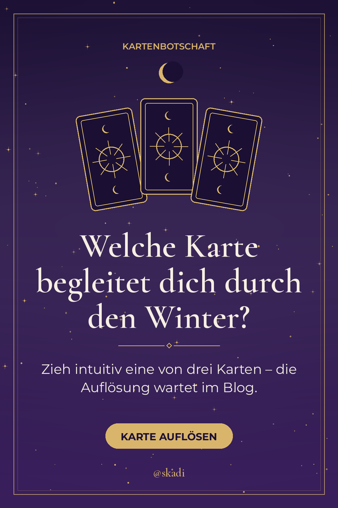
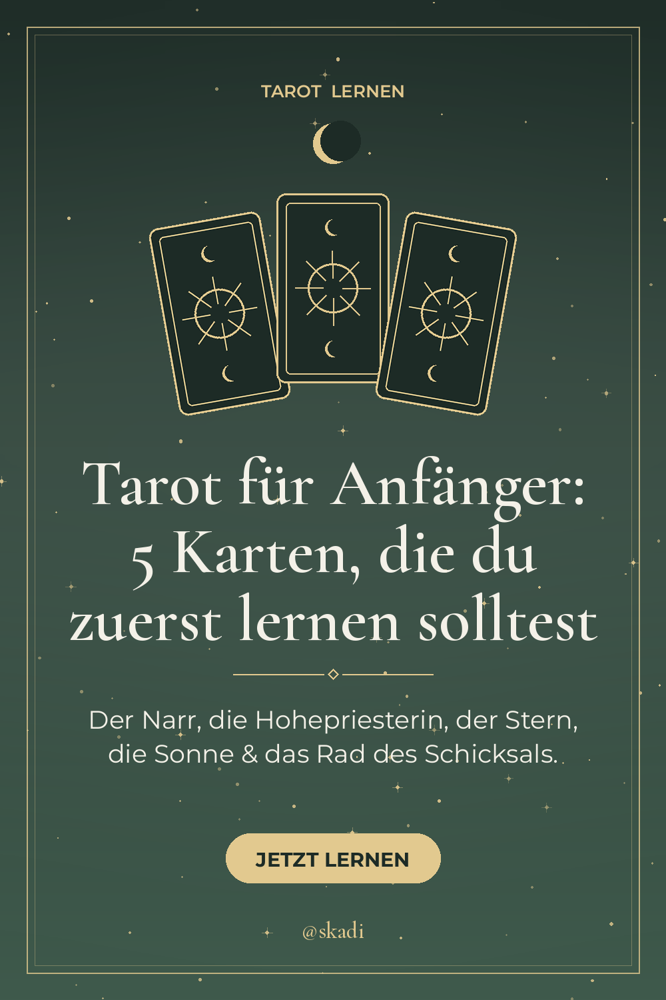

# Content-Plan 2026-11-21

## Trend-Grundlage

- Pinterest Hobbies Report 2026: 'tarot cards for beginners' +558 %, 'crystals and meanings' +606 %, 'moon water ritual' +186 %, 'energy cleansing ritual' +101 %
- Kitchen-Witch-Trend (gemütliche DIY-Rituale) – passt perfekt zu Winter/Rauhnächten
- TikTok: 'Pick a card' mit 3 Stapeln + 'Deine Tarotkarte für 2027 aus dem Geburtsdatum' (Jahreswechsel naht)
- Saisonal: Rauhnächte (25.12.–6.1.) – Suchvolumen steigt ab Ende November stark

## Pinterest – 5 Pins

Trage deinen Link in `plan.json` (Feld `link`) **oder** direkt in `pinterest_bulk.csv` ein.

### Pin 1 · 08:15 Uhr · Board: Tarot Karte des Tages

**Titel:** Tarot Pick a Card: Deine Winter-Botschaft

**Beschreibung:**

Wähle intuitiv Karte 1, 2 oder 3 und entdecke, welche Energie dich durch die dunkle Jahreszeit trägt. Ideal für deine Morgenroutine oder als kleine Auszeit zwischendurch. Tarot Karte des Tages, Kartenlegen, Winter Ritual, Intuition stärken.

**Alt-Text:** Drei verdeckte Tarotkarten auf dunklem Sternenhimmel mit Text: Welche Karte begleitet dich durch den Winter?

**Link-Ziel:** blog → `LINK EINFÜGEN` (Idee: Blogartikel mit Auflösung der 3 Karten)

### Pin 2 · 11:45 Uhr · Board: Rituale & Mondmagie

**Titel:** Rauhnächte 2026/27 vorbereiten – 13-Wünsche-Ritual mit Checkliste

**Beschreibung:**

Die Rauhnächte beginnen am 25. Dezember. Mit dieser Schritt-für-Schritt-Anleitung bereitest du das 13-Wünsche-Ritual entspannt vor: Wünsche formulieren, Räuchern, Journaling. Inklusive druckbarer PDF-Checkliste. Rauhnächte Ritual, Rauhnächte Wünsche, Jahresrückblick.

**Alt-Text:** Mondnacht-Grafik mit Text: Rauhnächte 2026/27 – so bereitest du dich jetzt vor

**Link-Ziel:** pdf → `LINK EINFÜGEN` (Idee: Rauhnächte-PDF / Checkliste)

### Pin 3 · 15:30 Uhr · Board: Tarot lernen für Anfänger

**Titel:** Tarot für Anfänger: Diese 5 Karten zuerst lernen

**Beschreibung:**

Du willst Tarot lernen, weißt aber nicht, wo du anfangen sollst? Starte mit diesen 5 großen Arkana – sie erklären die Grundenergie des ganzen Decks. Mit Bedeutungen und Merksätzen. Tarot lernen, Tarotkarten Bedeutung, Große Arkana.

**Alt-Text:** Drei Tarotkarten-Rückseiten auf grünem Hintergrund mit Text: Tarot für Anfänger – 5 Karten zuerst lernen

**Link-Ziel:** blog → `LINK EINFÜGEN` (Idee: Anfänger-Guide im Blog)

### Pin 4 · 19:00 Uhr · Board: Mystische Fundstücke

**Titel:** Das beste Tarot-Deck für Anfänger – 3 Empfehlungen

**Beschreibung:**

Welches Tarot-Deck passt zu dir als Anfängerin? Drei Decks mit klarer Symbolik und deutschem Begleitbuch, die das Lernen leicht machen – plus worauf du beim Kauf achten solltest.

*Werbung: Affiliate-Link. Beim Kauf erhalte ich eine kleine Provision – für dich ändert sich nichts am Preis.

**Alt-Text:** Rosafarbene Grafik mit Text: Dein erstes Tarot-Deck – 3 Decks, die sich leicht lesen lassen

**Link-Ziel:** amazon → `LINK EINFÜGEN` (Idee: Amazon-Link oder Blogartikel mit Deck-Vergleich)

### Pin 5 · 21:30 Uhr · Board: Spirituelle Downloads & PDFs

**Titel:** Jahresrückblick Journal: 30 Fragen zum Ausdrucken (PDF)

**Beschreibung:**

Mit diesen 30 Journaling-Fragen blickst du liebevoll auf 2026 zurück und setzt klare Intentionen für 2027. Perfekt für die Rauhnächte, Silvester oder einen ruhigen Sonntag. Journal Prompts Deutsch, Jahresrückblick, Intentionen setzen.

**Alt-Text:** Helle Grafik mit Text: 30 Journal-Fragen für den Jahresabschluss

**Link-Ziel:** pdf → `LINK EINFÜGEN` (Idee: Journal-PDF im Blog-Shop)

## Video: 2026-11-21-pick-a-card (pick_a_card)
Datei: `videos/2026-11-21-pick-a-card.mp4`

**Caption (Insta & TikTok):**

Welche Karte hast du gewählt? 1, 2 oder 3? Schreib's in die Kommentare ✨ Speichere das Video, damit du es in den Rauhnächten wiederfindest.

#tarot #pickacard #kartenlegen #tarotdeutsch #spiritualität #rauhnächte #kartedestages

**Sound:** Ruhiger, atmosphärischer Trend-Sound (in der App unter 'Trending' / 'Beliebt' filtern), Lautstärke ca. 10–15 %

**Erster Kommentar (anpinnen):** Willst du deine persönliche Legung? Infos über den Link in meiner Bio 🌙

---
_Kartenlegen dient der Selbstreflexion und Unterhaltung und ersetzt keine ärztliche, psychologische oder rechtliche Beratung._
