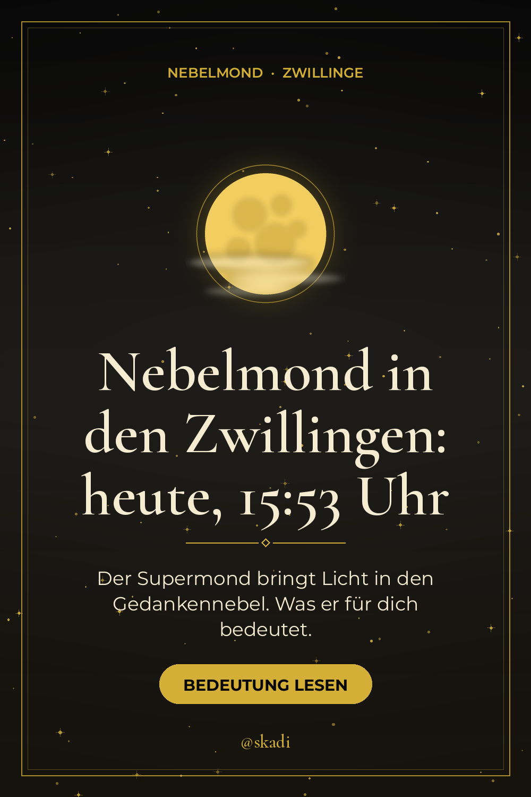
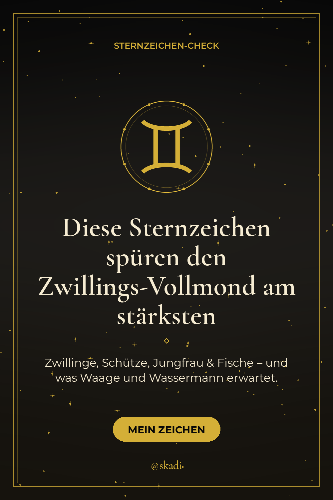
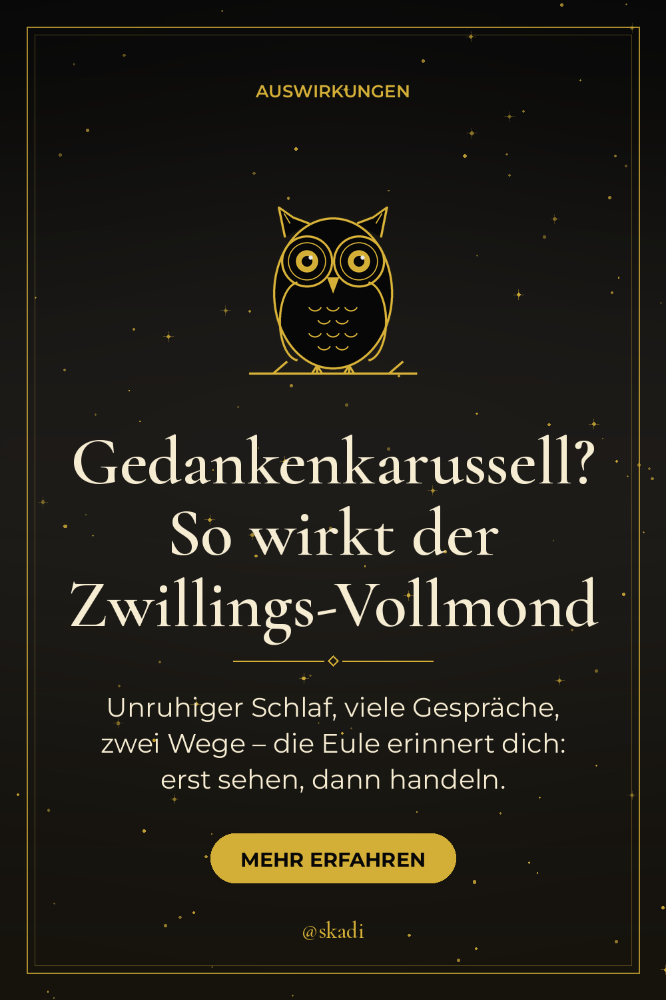
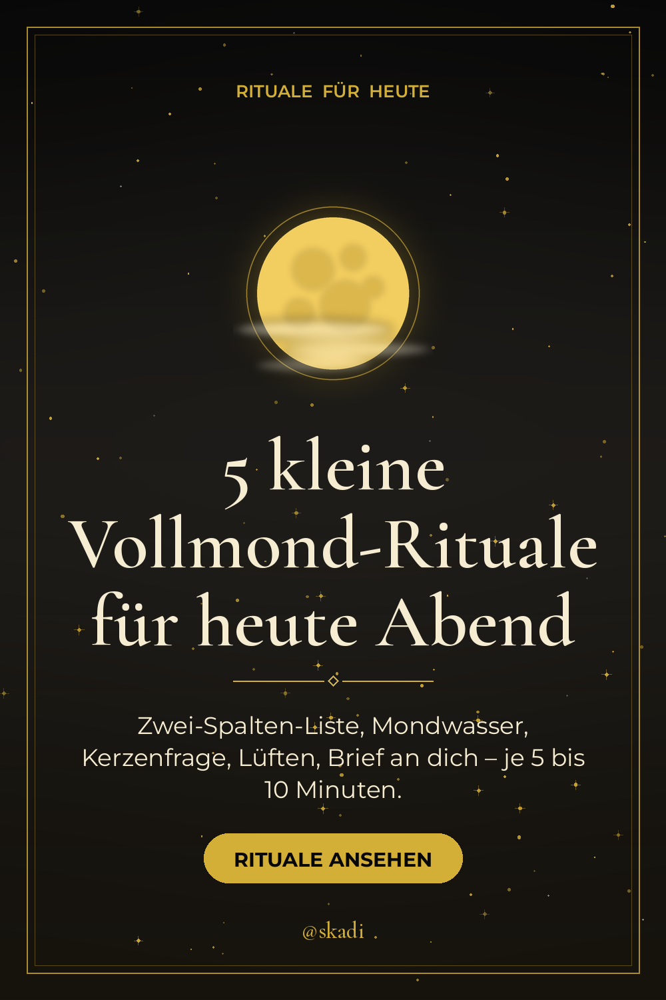
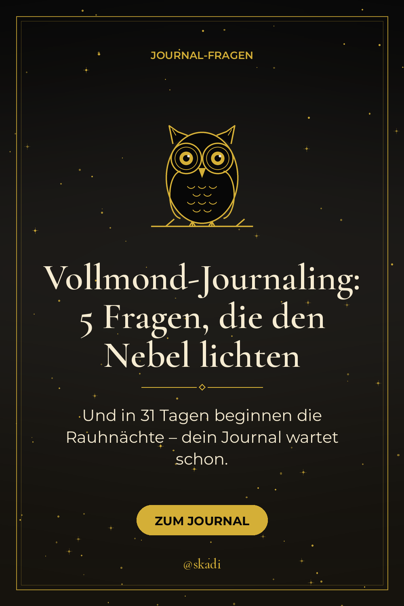

# Content-Plan 2026-11-24

## Trend-Grundlage

- Heute 15:53 Uhr: Vollmond (Nebelmond) in den Zwillingen – zugleich Supermond, sichtbar 23.–25.11., Mondaufgang Berlin ca. 15:16 Uhr
- Medien greifen den 'Nebelmond'/'Supermond 24. November' und 'Was erwartet dein Sternzeichen' auf – hohes Suchinteresse heute
- Format: Sternzeichen-Check + kleine Rituale für den Abend; Countdown: noch 31 Tage bis zur ersten Rauhnacht

## Pinterest – 5 Pins

Trage deinen Link in `plan.json` (Feld `link`) **oder** direkt in `pinterest_bulk.csv` ein.

### Pin 1 · 08:15 Uhr · Board: Rituale & Mondmagie

**Titel:** Vollmond Zwillinge 24. November 2026: Bedeutung des Nebelmonds

**Beschreibung:**

Am 24. November um 15:53 Uhr steht der Vollmond in den Zwillingen – der Nebelmond, diesmal sogar als Supermond. Astrologisch geht es um Gedanken, Worte und Entscheidungen: Was im Kopf kreist, will ausgesprochen oder geklärt werden. Hier erfährst du, was dieser Vollmond bedeuten kann und wie du ihn bewusst für dich nutzt.

**Alt-Text:** Goldener Vollmond mit Nebelschleiern auf schwarzem Sternenhimmel, Text: Nebelmond in den Zwillingen – heute, 15:53 Uhr

**Link-Ziel:** blog → `LINK EINFÜGEN` (Idee: Blogartikel Vollmond in den Zwillingen)

### Pin 2 · 11:45 Uhr · Board: Tarot Karte des Tages

**Titel:** Vollmond in den Zwillingen: Diese Sternzeichen sind besonders betroffen

**Beschreibung:**

Der Vollmond in den Zwillingen wirkt astrologisch vor allem auf die beweglichen Zeichen: Zwillinge, Schütze, Jungfrau und Fische. Waage und Wassermann dürfen sich über frische Ideen freuen. Finde heraus, was der Nebelmond für dein Sternzeichen bedeuten kann – als Impuls für deine Selbstreflexion.

**Alt-Text:** Goldenes Zwillinge-Symbol im Kreis auf schwarzem Grund, Text: Diese Sternzeichen spüren den Zwillings-Vollmond am stärksten

**Link-Ziel:** blog → `LINK EINFÜGEN` (Idee: Blogartikel Vollmond + Sternzeichen)

### Pin 3 · 15:30 Uhr · Board: Self-Care & Journaling

**Titel:** Vollmond Zwillinge Auswirkungen: Unruhe, Gespräche und Klarheit

**Beschreibung:**

Viele erleben Vollmondtage als aufgewühlt: Gedanken kreisen, Gespräche werden intensiver, Entscheidungen zwischen zwei Möglichkeiten drängen sich auf. Der Zwillings-Vollmond lädt dazu ein, den Kopf zu leeren, ehrlich zu sprechen und dir selbst zuzuhören. Mit sanften Self-Care-Impulsen für heute Abend.

**Alt-Text:** Goldene Eule in Linienzeichnung auf schwarzem Grund, Text: Gedankenkarussell? So wirkt der Zwillings-Vollmond

**Link-Ziel:** pdf → `LINK EINFÜGEN` (Idee: Rauhnächte-Journal PDF (oder Blogartikel Vollmond))

### Pin 4 · 19:00 Uhr · Board: Rituale & Mondmagie

**Titel:** Vollmond Ritual Zwillinge: 5 einfache Rituale für heute Abend

**Beschreibung:**

Du brauchst keine Stunden für ein Vollmond-Ritual. Diese fünf kleinen Rituale passen zum Zwillings-Vollmond und in jeden Abend: eine Zwei-Spalten-Liste zum Loslassen, Mondwasser, eine Kerzenfrage, bewusstes Lüften gegen den Gedankennebel und ein kurzer Brief an dich selbst. Vollmond Ritual, Loslassen Ritual, Self-Care.

**Alt-Text:** Goldener Vollmond über Nebel auf schwarzem Grund, Text: 5 kleine Vollmond-Rituale für heute Abend

**Link-Ziel:** pdf → `LINK EINFÜGEN` (Idee: Rauhnächte-Journal PDF (oder Blogartikel Vollmond-Rituale))

### Pin 5 · 21:30 Uhr · Board: Spirituelle Downloads & PDFs

**Titel:** Vollmond Journaling Fragen: 5 Impulse für Klarheit (Zwillinge)

**Beschreibung:**

Was beschäftigt dich gerade wirklich? Welches Gespräch schiebst du auf? Welche zwei Wege liegen vor dir? Mit diesen fünf Journal-Fragen nutzt du den Zwillings-Vollmond für mehr Klarheit. Und wenn dir das Schreiben guttut: In 31 Tagen beginnen die Rauhnächte – mit meinem Rauhnächte-Journal begleitest du dich durch alle 12 Nächte.

**Alt-Text:** Goldene Eule auf schwarzem Grund, Text: Vollmond-Journaling – 5 Fragen, die den Nebel lichten

**Link-Ziel:** pdf → `LINK EINFÜGEN` (Idee: Rauhnächte-Journal PDF)

## Video: 2026-11-24-nebelmond-zwillinge (card_meaning)
Datei: `videos/2026-11-24-nebelmond-zwillinge.mp4`

**Caption (Insta & TikTok):**

Spürst du den Nebelmond schon? 🌕 Schreib dein Sternzeichen in die Kommentare – und speichere das Video für den nächsten Vollmond. (Astrologie als Impuls zur Selbstreflexion ✨)

#vollmond #nebelmond #vollmondzwillinge #supermond #astrologie #spiritualität #fullmoon

**Sound:** Mystischer, ruhiger Trend-Sound (Ambient/Choir) in der App unter 'Beliebt' wählen, Lautstärke ca. 10–15 %

**Erster Kommentar (anpinnen):** Welche Zeichen soll ich beim nächsten Vollmond genauer anschauen? 🦉 Mein Rauhnächte-Journal findest du über den Link in der Bio.

## Video: 2026-11-24-vollmond-rituale (ritual_steps)
Datei: `videos/2026-11-24-vollmond-rituale.mp4`

**Caption (Insta & TikTok):**

Welches Ritual probierst du heute Abend aus – 1, 2, 3, 4 oder 5? 🕯 Speichere dir das Video für jeden Vollmond.

#vollmondritual #ritual #mondwasser #selfcare #loslassen #rauhnächte #moonritual

**Sound:** Sanfter Piano- oder ASMR-Trend-Sound (in der App unter 'Beliebt'), Lautstärke ca. 10 %

**Erster Kommentar (anpinnen):** Der Brief aus Ritual 5 passt perfekt in die erste Rauhnacht – mein Rauhnächte-Journal findest du über den Link in der Bio 🌙

---
_Kartenlegen dient der Selbstreflexion und Unterhaltung und ersetzt keine ärztliche, psychologische oder rechtliche Beratung._
