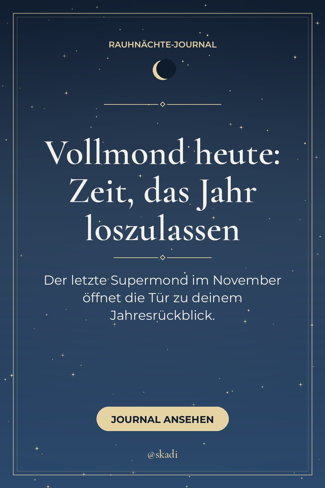
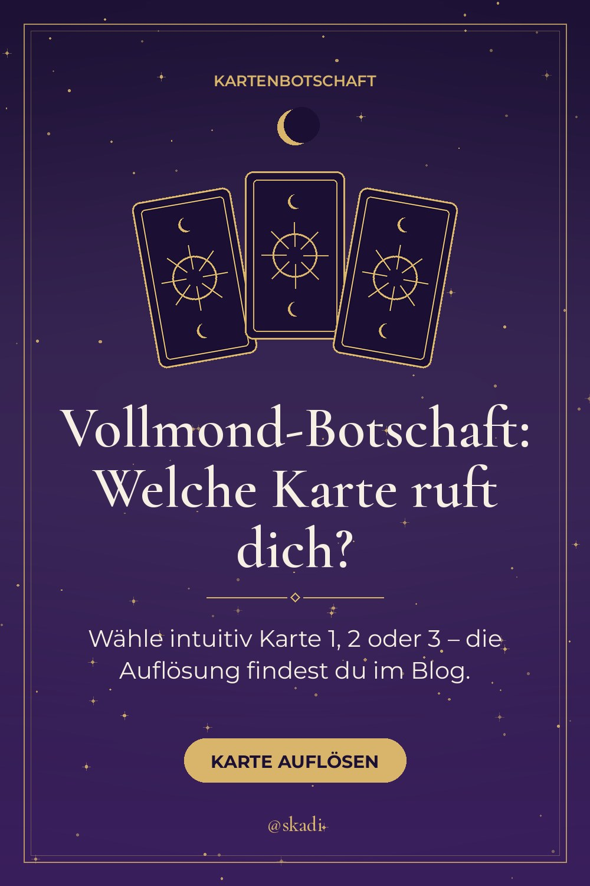
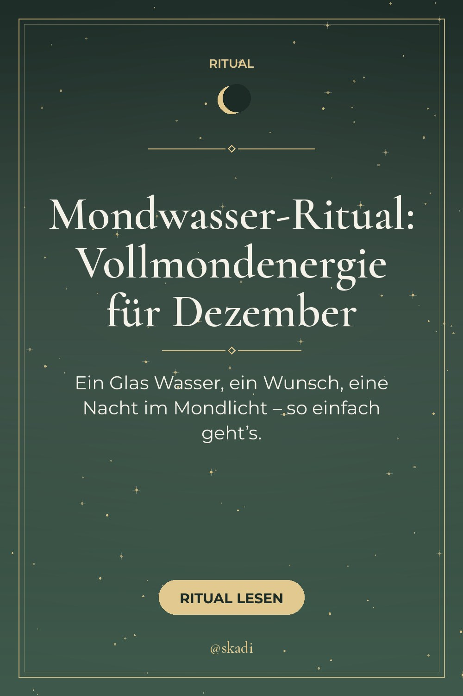
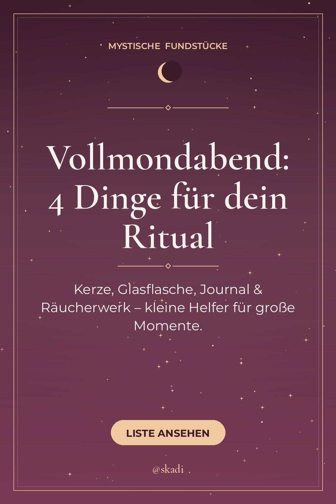
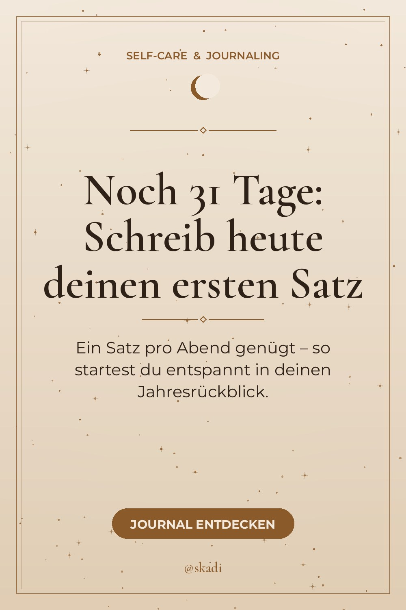

# Inhalte aus dem Morgenlauf 2026-11-24

## Pin 1 · 08:15 Uhr · Spirituelle Downloads & PDFs

**Titel:** Vollmond Ritual November: Loslassen & Jahresrückblick mit dem Rauhnächte Journal

Der Vollmond am 24. November lädt dich ein, Ballast abzugeben, bevor die Rauhnächte beginnen. Nimm dir heute Abend 15 Minuten, schreib auf, was du in diesem Jahr loslassen möchtest, und beginne deinen Jahresrückblick. Im Rauhnächte-Journal zum Ausdrucken findest du Fragen für den Rückblick, das 13-Wünsche-Ritual und Impulse für alle 12 Nächte.

Link: Rauhnächte-Journal PDF

## Pin 2 · 11:45 Uhr · Tarot Karte des Tages

**Titel:** Tarot Pick a Card Vollmond: Deine Botschaft zum Supermond im November

Halte kurz inne, atme tief durch und wähle intuitiv Karte 1, 2 oder 3. Welche Botschaft hält der Vollmond heute für dich bereit? Ein kleiner Impuls zur Selbstreflexion für deinen Abend – ganz ohne Vorkenntnisse. Tarot Karte des Tages, Vollmond Tarot, Kartenlegen für dich.

Link: Blogartikel mit Auflösung der 3 Karten

## Pin 3 · 15:30 Uhr · Rituale & Mondmagie

**Titel:** Mondwasser Ritual Vollmond – einfache Anleitung für die Rauhnächte

Mondwasser gehört zu den beliebtesten Ritualen auf Pinterest. Stell heute ein Glas Wasser ins Mondlicht, sprich deine Intention aus und nutze das Wasser in den Rauhnächten für dein Räucher- oder Wunschritual. Im Rauhnächte-Journal findest du dazu passende Journaling-Fragen und eine Ritual-Anleitung für jede der 12 Nächte.

Link: Rauhnächte-Journal PDF (oder Blogartikel Mondwasser)

## Pin 4 · 19:00 Uhr · Mystische Fundstücke

**Titel:** Vollmond Ritual Zubehör: Kerze, Mondwasser-Flasche, Journal & Räucherwerk

Für dein Vollmondritual brauchst du nicht viel: eine Kerze, eine schöne Glasflasche für Mondwasser, ein Journal und etwas Räucherwerk. Hier findest du meine liebsten Begleiter für ruhige Ritualabende – auch als kleine Geschenkidee für spirituelle Freundinnen.

*Werbung: Affiliate-Link. Beim Kauf erhalte ich eine kleine Provision – für dich ändert sich nichts am Preis.

Link: Amazon-Partnerlink oder Blogartikel mit Partnerlinks

## Pin 5 · 21:30 Uhr · Self-Care & Journaling

**Titel:** Jahresrückblick schreiben: Journaling Fragen für einen ruhigen Jahresabschluss

Noch 31 Tage bis zur ersten Rauhnacht. Statt den Dezember durchzuhetzen, schenk dir jeden Abend einen einzigen Satz: Was hat mich dieses Jahr stark gemacht? Wofür bin ich dankbar? Mit dem Rauhnächte-Journal wird daraus ein liebevoller Jahresrückblick. Journaling Prompts, Self-Care Ritual, Jahresabschluss.

Link: Rauhnächte-Journal PDF

## Video 2026-11-24-vollmond-pick-a-card

Heute um 15:53 Uhr ist Vollmond 🌕 Welche Karte hast du gewählt – 1, 2 oder 3? Schreib es in die Kommentare und speichere das Video für deinen Vollmondabend.

#vollmond #pickacard #tarot #kartenlegen #rauhnächte #selfcare #witchtok

Sound: Mystischer Ambient- oder Glocken-Trend-Sound (in der App unter 'Beliebt'), leise im Hintergrund

Kommentar: Im Rauhnächte-Journal findest du die 13-Wünsche-Vorlage und Journaling-Fragen für alle 12 Nächte – Link in der Bio ✨
