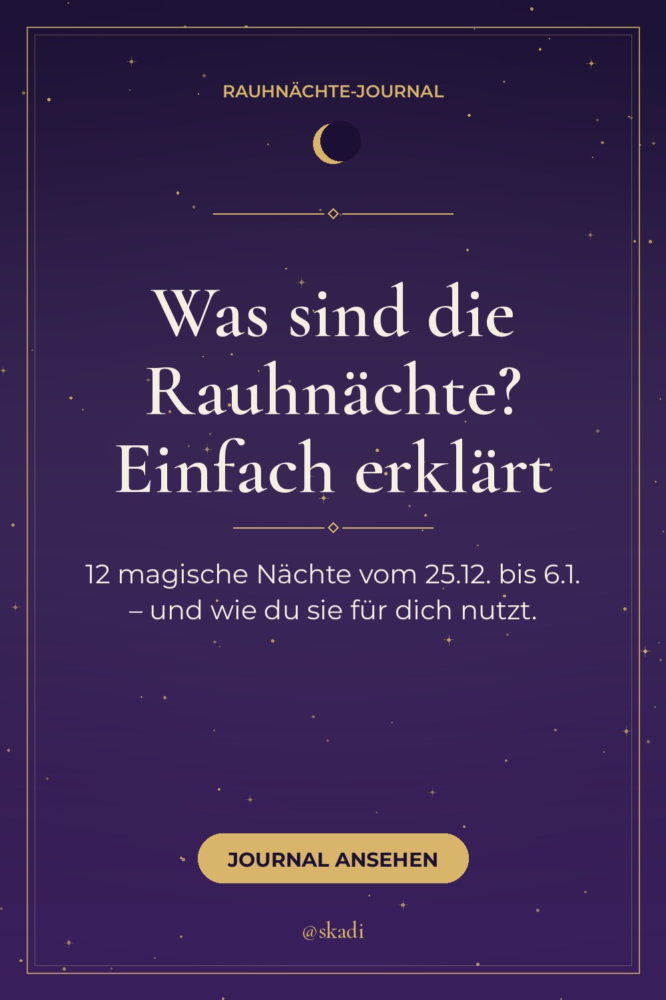
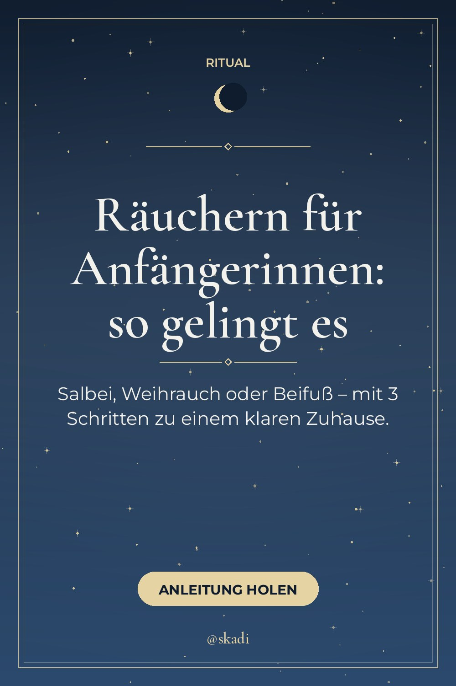
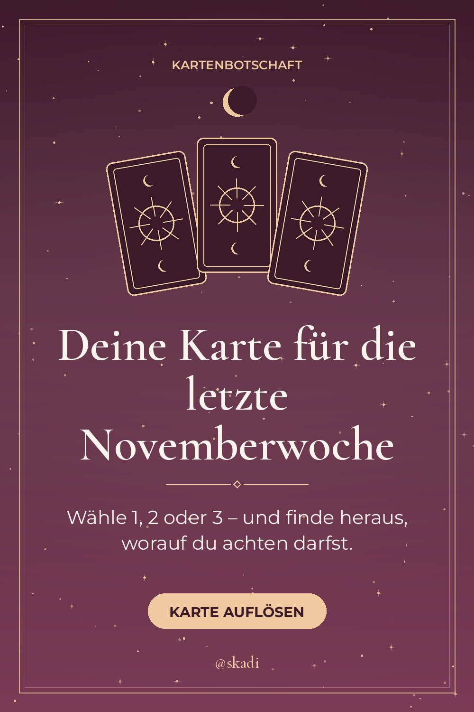
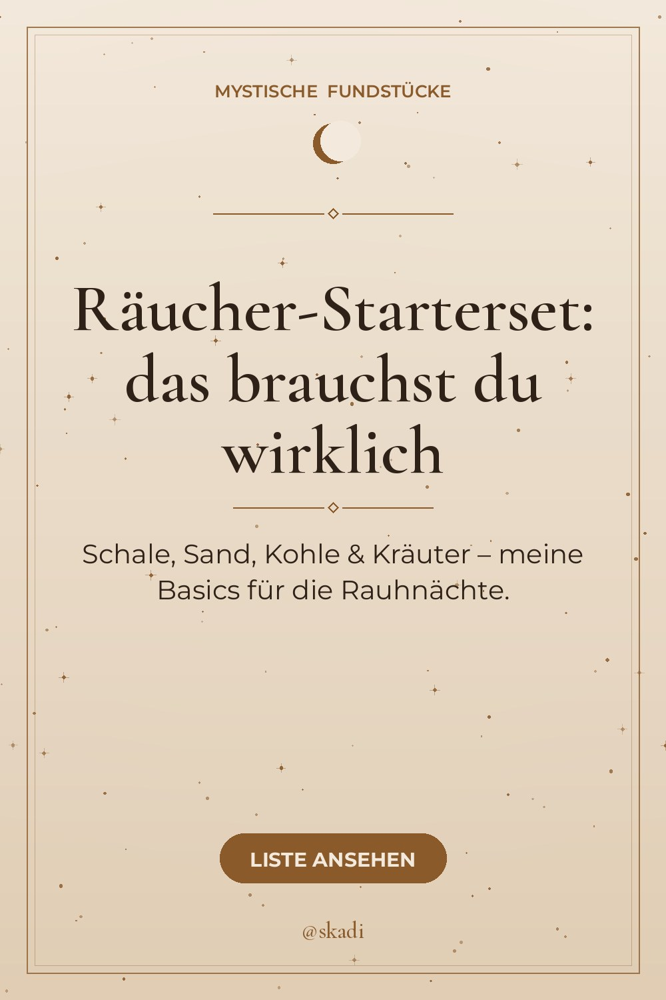

# Inhalte aus dem Morgenlauf 2026-11-25

## Pin 1 · 08:15 Uhr · Spirituelle Downloads & PDFs

**Titel:** Was sind die Rauhnächte? Bedeutung, Datum & Rituale einfach erklärt

Die Rauhnächte sind die 12 Nächte zwischen dem 25. Dezember und dem 6. Januar. Jede Nacht steht für einen Monat des neuen Jahres – eine Zeit zum Innehalten, Räuchern, Wünschen und Reflektieren. Hier erfährst du einfach erklärt, woher der Brauch kommt und wie du ihn mit dem Rauhnächte-Journal zum Ausdrucken für dich gestaltest.

Link: Rauhnächte-Journal PDF

## Pin 2 · 11:45 Uhr · Rituale & Mondmagie

**Titel:** Räuchern Rauhnächte für Anfänger – Anleitung Schritt für Schritt

Räuchern ist ein fester Teil der Rauhnächte. Du brauchst nur eine feuerfeste Schale, Räucherkohle oder ein Stövchen und Kräuter wie Beifuß, Salbei oder Weihrauch. Öffne ein Fenster, geh langsam durch die Räume und setz eine Intention. Eine ausführliche Räucher-Anleitung für jede Nacht findest du im Rauhnächte-Journal.

Link: Rauhnächte-Journal PDF (Räucher-Anleitung)

## Pin 3 · 15:30 Uhr · Tarot Karte des Tages

**Titel:** Tarot Karte des Tages: Pick a Card für die letzte Novemberwoche

Welche Energie begleitet dich durch die letzte Novemberwoche? Wähle intuitiv eine der drei Karten und lies im Blog, welcher Impuls zur Selbstreflexion auf dich wartet. Perfekt für deine Morgenroutine mit einer Tasse Tee. Kartenlegen, Tarot Botschaft, Pick a Card.

Link: Blogartikel mit Auflösung der 3 Karten

## Pin 4 · 19:00 Uhr · Self-Care & Journaling

**Titel:** Journaling Prompts gegen Stress: 3 Fragen für ruhige Abende im Dezember

Wenn der Kopf abends voll ist, helfen drei einfache Fragen: Was hat mir heute gutgetan? Was darf ich loslassen? Was brauche ich morgen? Fünf Minuten Journaling können dir helfen, zur Ruhe zu kommen. Noch mehr liebevolle Fragen für die Zeit zwischen den Jahren findest du im Rauhnächte-Journal.

Link: Rauhnächte-Journal PDF

## Pin 5 · 21:30 Uhr · Mystische Fundstücke

**Titel:** Räucherset für Anfänger: Grundausstattung für die Rauhnächte

Du möchtest in den Rauhnächten räuchern, weißt aber nicht, was du brauchst? Eine feuerfeste Räucherschale, Räuchersand, Räucherkohle oder ein Stövchen und ein paar Kräuter reichen für den Anfang. Hier findest du meine Empfehlungen für ein einfaches Räucher-Starterset.

*Werbung: Affiliate-Link. Beim Kauf erhalte ich eine kleine Provision – für dich ändert sich nichts am Preis.

Link: Amazon-Partnerlink oder Blogartikel mit Partnerlinks

## Video 2026-11-25-rauhnaechte-erklaert

Noch 30 Tage bis zur ersten Rauhnacht 🌙 Feierst du die Rauhnächte schon oder ist es dein erstes Mal? Erzähl’s mir in den Kommentaren – und speichere das Video für später.

#rauhnächte #rauhnacht #ritual #spiritualität #selfcare #wintermagic #journaling

Sound: Sanfter Winter-/Klavier-Trend-Sound, ruhig und warm

Kommentar: Im Rauhnächte-Journal findest du die 13-Wünsche-Vorlage und Journaling-Fragen für alle 12 Nächte – Link in der Bio ✨
