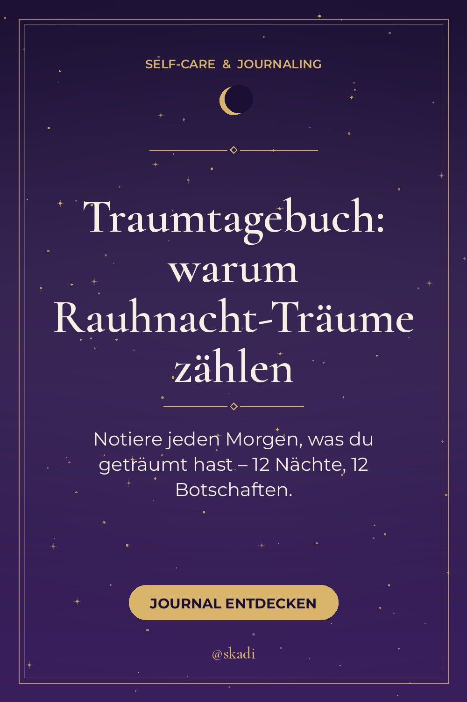
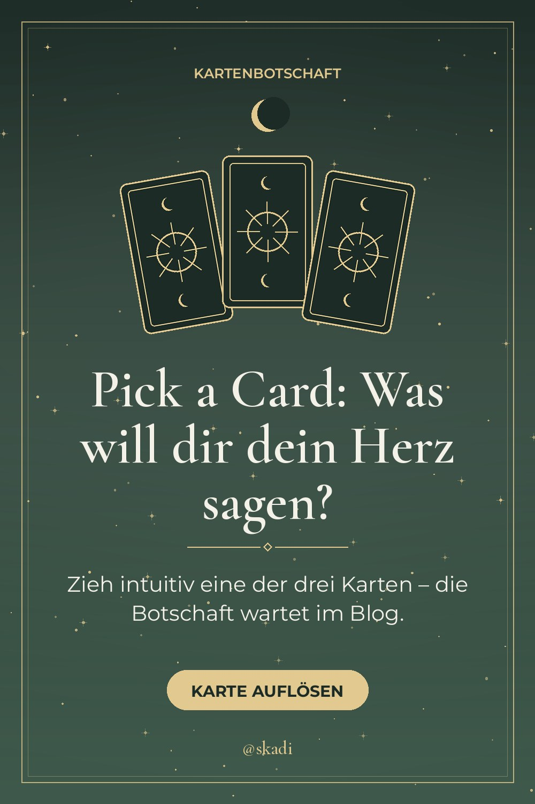
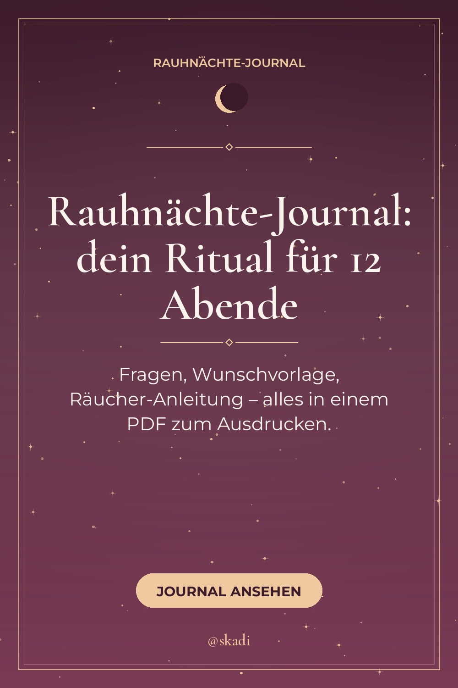
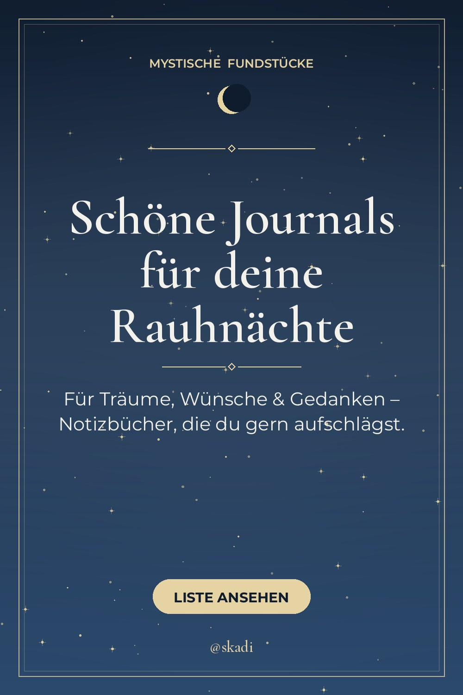
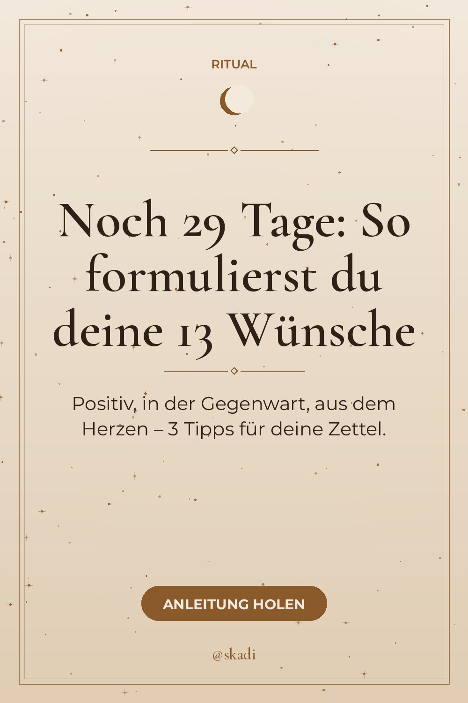

# Inhalte aus dem Morgenlauf 2026-11-26

## Pin 1 · 08:15 Uhr · Self-Care & Journaling

**Titel:** Traumtagebuch Rauhnächte: Träume deuten & für das neue Jahr notieren

Dream Journaling ist einer der großen Pinterest-Trends – und in den Rauhnächten besonders schön. Der Brauch sagt: Jede Nacht spiegelt einen Monat des neuen Jahres. Notiere morgens Bilder, Gefühle und Farben aus deinen Träumen und betrachte sie als Impulse zur Selbstreflexion. Im Rauhnächte-Journal ist für jede Nacht Platz für dein Traumtagebuch.

Link: Rauhnächte-Journal PDF

## Pin 2 · 11:45 Uhr · Tarot Karte des Tages

**Titel:** Pick a Card Tarot: Was will dir dein Herz gerade sagen?

Manchmal ist unser Herz leiser als unser Alltag. Wähle intuitiv Karte 1, 2 oder 3 und entdecke im Blog einen Impuls, der dich einlädt, wieder bei dir anzukommen. Tarot Karte des Tages, Kartenlegen und Selbstreflexion in nur zwei Minuten – ideal für deine Morgenroutine.

Link: Blogartikel mit Auflösung der 3 Karten

## Pin 3 · 15:30 Uhr · Spirituelle Downloads & PDFs

**Titel:** Rauhnächte Journal zum Ausdrucken – 12 Abende Ritual & Journaling

Mit dem Rauhnächte-Journal hast du für jede der 12 Nächte einen liebevollen Plan: eine Journaling-Frage, Platz für Träume und Zeichen, das 13-Wünsche-Ritual mit Vorlage, eine Räucher-Anleitung und einen Jahresrückblick. Einfach ausdrucken, Kerze anzünden und dir jeden Abend eine kleine Auszeit schenken.

Link: Rauhnächte-Journal PDF

## Pin 4 · 19:00 Uhr · Mystische Fundstücke

**Titel:** Journal Notizbuch für Rauhnächte & Traumtagebuch – schöne Ideen

Ein schönes Notizbuch macht das Schreiben zum Ritual. Ob für Traumtagebuch, Dankbarkeit oder Wünsche: Hier findest du Journals und Stifte, die sich wunderbar für die Rauhnächte und ein bewusstes neues Jahr eignen – auch als liebevolle Geschenkidee für Weihnachten.

*Werbung: Affiliate-Link. Beim Kauf erhalte ich eine kleine Provision – für dich ändert sich nichts am Preis.

Link: Amazon-Partnerlink oder Blogartikel mit Partnerlinks

## Pin 5 · 21:30 Uhr · Rituale & Mondmagie

**Titel:** 13 Wünsche Rauhnächte formulieren: 3 Tipps & Beispiele

Für das 13-Wünsche-Ritual schreibst du 13 Herzenswünsche auf einzelne Zettel. Formuliere sie positiv, in der Gegenwart und so, dass sie sich gut anfühlen: 'Ich lebe mit mehr Leichtigkeit' statt 'Ich will weniger Stress'. Noch 29 Tage – genug Zeit, um in Ruhe zu sammeln. Die Wunschvorlage findest du im Rauhnächte-Journal.

Link: Rauhnächte-Journal PDF (Wunschvorlage)

## Video 2026-11-26-13-wuensche-formulieren

Noch 29 Tage bis zur ersten Rauhnacht ✨ Wie viele deiner 13 Wünsche hast du schon? Schreib die Zahl in die Kommentare und speichere dir die Anleitung.

#13wünsche #rauhnächte #manifestieren #ritual #selfcare #wünsche #spiritualtiktok

Sound: Leiser, hoffnungsvoller Piano-Trend-Sound

Kommentar: Im Rauhnächte-Journal findest du die 13-Wünsche-Vorlage und Journaling-Fragen für alle 12 Nächte – Link in der Bio ✨
