# Kampagne: Yule & die Raunächte – 30 Pins bis zur 1. Raunacht

30 Pins passend zum PDF „Yule & die Raunächte“, je einer pro Tag vom 25.11. bis 24.12., um 20:15 Uhr. Info-Pins (mit Merken-Lesezeichen) laden zum Speichern ein; die Links trägst du selbst ein.

## 1. 2026-11-25 · 20:15 Uhr · Info
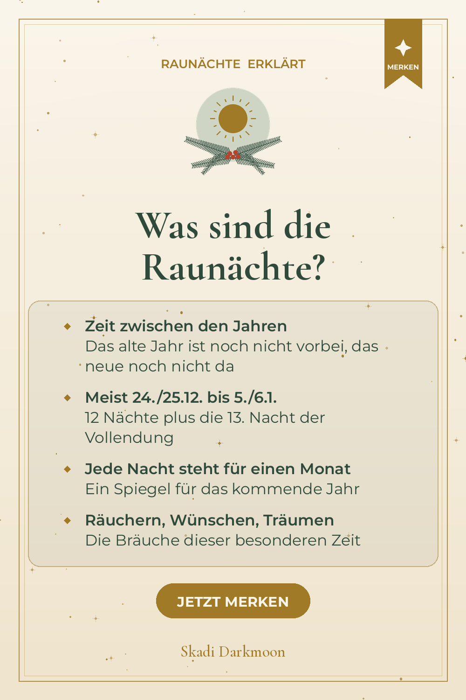

**Titel:** Was sind die Raunächte? Bedeutung, Datum & Bräuche einfach erklärt

**Beschreibung:**

Die Raunächte (auch Rauhnächte) sind die Zeit zwischen den Jahren: meist die Nächte vom 24./25. Dezember bis 5./6. Januar. Jede Nacht steht für einen Monat des neuen Jahres. Geräuchert, gewünscht und geträumt wird seit Jahrhunderten. Merk dir diesen Pin – und hol dir das ganze Wissen samt Journal für 13 Nächte in meinem Begleitbuch.

**Board:** Raunächte & Yule  
**Alt-Text:** Pin im Stil des Begleitbuchs mit Titel „Was sind die Raunächte?“ und Info-Liste zum Speichern  
**Link:** PDF „Yule & die Raunächte“

## 2. 2026-11-26 · 20:15 Uhr · PDF
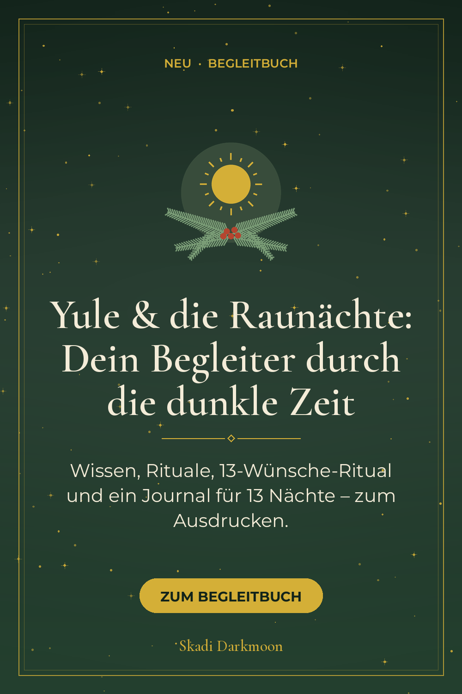

**Titel:** Raunächte Journal PDF: Yule & die Raunächte – Begleitbuch zum Ausdrucken

**Beschreibung:**

77 Seiten für deine Zeit zwischen den Jahren: Yule und Wintersonnenwende, Herkunft der Raunächte, Wilde Jagd, alte Bräuche, Checkliste, Räuchermischung, das 13-Wünsche-Ritual mit Wunschkärtchen und ein Journal für jede der 13 Nächte mit Thema, Monat, Loslass-Impuls und Affirmation. Ehrlich recherchiert: Was ist belegt, was Volksglaube, was moderne Praxis.

**Board:** Spirituelle Downloads & PDFs  
**Alt-Text:** Tannengrüne Grafik mit goldener Sonne über Tannenzweigen, Text: Yule & die Raunächte – Dein Begleiter durch die dunkle Zeit  
**Link:** PDF „Yule & die Raunächte“

## 3. 2026-11-27 · 20:15 Uhr · Info
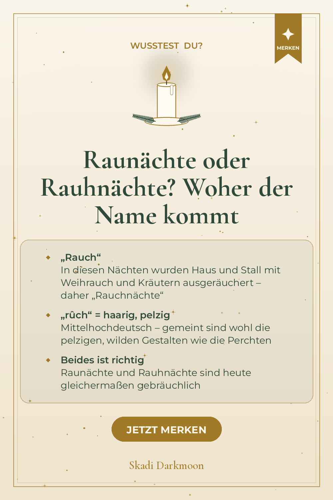

**Titel:** Raunächte oder Rauhnächte? Bedeutung und Herkunft des Namens

**Beschreibung:**

Schreibt man Raunächte oder Rauhnächte? Beides! Der Name geht wahrscheinlich auf zwei Wurzeln zurück: das Räuchern von Haus und Stall – und das mittelhochdeutsche „rûch“ für haarig, pelzig, wie die wilden Perchten in den Alpen. Speichere dir den Pin für deine Raunacht-Vorbereitung.

**Board:** Raunächte & Yule  
**Alt-Text:** Pin im Stil des Begleitbuchs mit Titel „Raunächte oder Rauhnächte? Woher der Name kommt“ und Info-Liste zum Speichern  
**Link:** Blogartikel Raunächte oder PDF „Yule & die Raunächte“

## 4. 2026-11-28 · 20:15 Uhr · Info
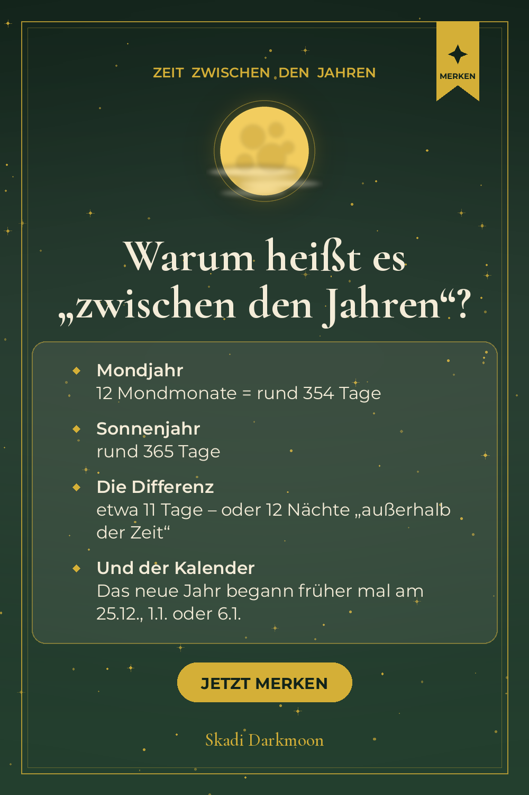

**Titel:** Zeit zwischen den Jahren: Warum es die Raunächte gibt (Mondjahr & Sonnenjahr)

**Beschreibung:**

Ein Mondjahr hat rund 354 Tage, ein Sonnenjahr 365 – dazwischen liegen etwa 11 Tage oder 12 Nächte. Eine verbreitete Erklärung für die Raunächte, auch wenn Fachleute darüber streiten. Sicher ist: Weil das neue Jahr früher an verschiedenen Tagen begann, gehörten die Tage dazwischen keinem Jahr eindeutig an.

**Board:** Raunächte & Yule  
**Alt-Text:** Tannengrüne Grafik mit goldenem Vollmond und Info-Liste: Mondjahr 354 Tage, Sonnenjahr 365 Tage  
**Link:** PDF „Yule & die Raunächte“

## 5. 2026-11-29 · 20:15 Uhr · Info
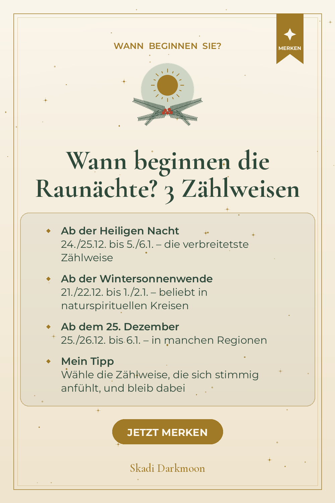

**Titel:** Raunächte 2026/27: Wann beginnen sie? Alle 3 Zählweisen im Überblick

**Beschreibung:**

Beginnen die Raunächte am 21., 24. oder 25. Dezember? Es gibt nicht die eine richtige Zählweise. Am verbreitetsten: von der Heiligen Nacht bis zur Nacht auf den Dreikönigstag. Wer Yule feiert, kann die Thomasnacht am 21. Dezember als Auftakt nehmen und beide Traditionen verbinden. Pin speichern, damit du den Start nicht verpasst.

**Board:** Raunächte & Yule  
**Alt-Text:** Pin im Stil des Begleitbuchs mit Titel „Wann beginnen die Raunächte? 3 Zählweisen“ und Info-Liste zum Speichern  
**Link:** PDF „Yule & die Raunächte“

## 6. 2026-11-30 · 20:15 Uhr · Info
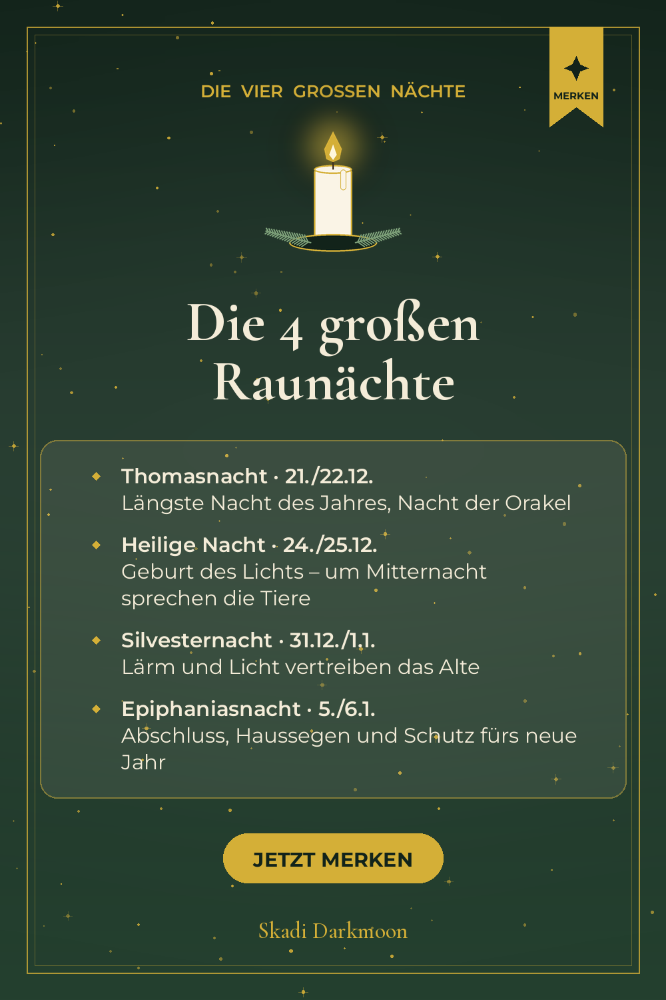

**Titel:** Die 4 großen Raunächte: Thomasnacht, Heilige Nacht, Silvester & Epiphanias

**Beschreibung:**

In vier Raunächten wurde traditionell das ganze Haus ausgeräuchert und gesegnet: Thomasnacht, Heilige Nacht, Silvesternacht und die Nacht vor dem Dreikönigstag. Hier erfährst du, wofür jede dieser Nächte steht – speichere dir die Übersicht für deine Raunachtszeit.

**Board:** Raunächte & Yule  
**Alt-Text:** Pin im Stil des Begleitbuchs mit Titel „Die 4 großen Raunächte“ und Info-Liste zum Speichern  
**Link:** PDF „Yule & die Raunächte“

## 7. 2026-12-01 · 20:15 Uhr · Info
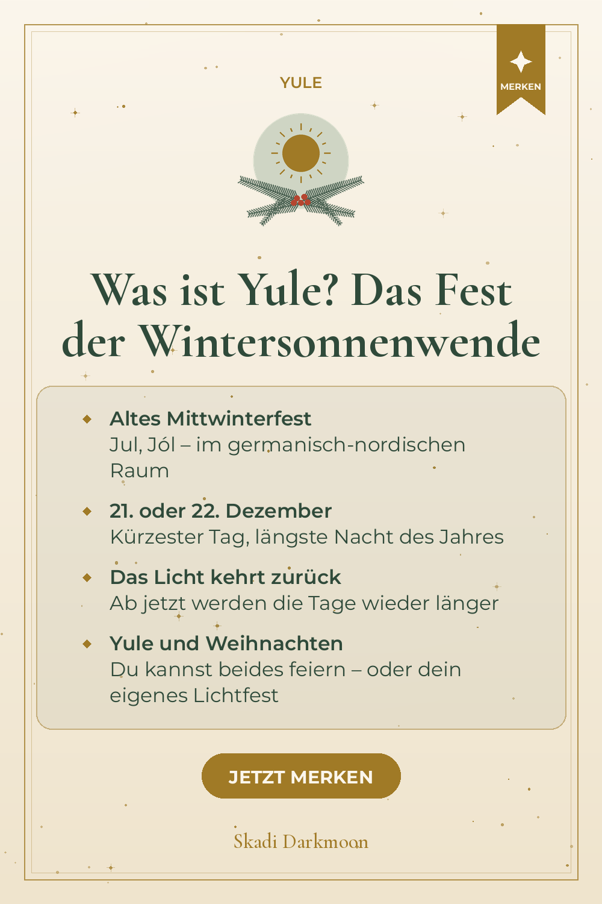

**Titel:** Was ist Yule? Bedeutung der Wintersonnenwende einfach erklärt

**Beschreibung:**

Yule (Jul, Jól) ist der alte Name für das Mittwinterfest. Heute feiern viele damit die Wintersonnenwende am 21. oder 22. Dezember – die längste Nacht, nach der das Licht zurückkehrt. Was historisch belegt ist und was moderne Deutung, liest du in meinem Begleitbuch „Yule & die Raunächte“.

**Board:** Raunächte & Yule  
**Alt-Text:** Pin im Stil des Begleitbuchs mit Titel „Was ist Yule? Das Fest der Wintersonnenwende“ und Info-Liste zum Speichern  
**Link:** PDF „Yule & die Raunächte“

## 8. 2026-12-02 · 20:15 Uhr · Info
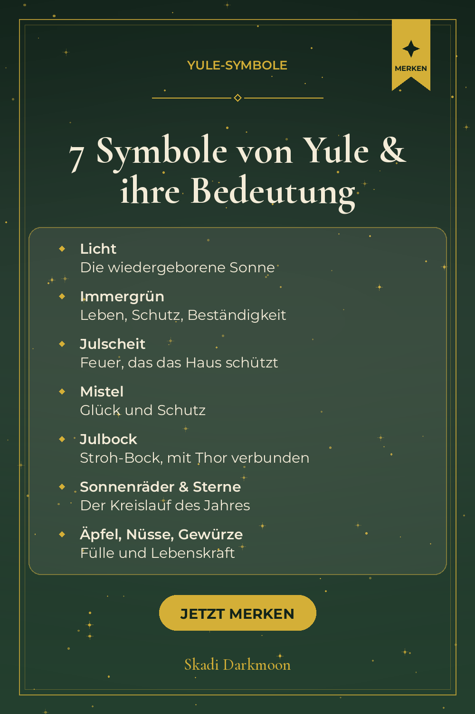

**Titel:** Yule Symbole und ihre Bedeutung: Licht, Immergrün, Julscheit & Mistel

**Beschreibung:**

Kerzen, Tannengrün, Julscheit, Mistel, Julbock, Strohsterne, Äpfel und Gewürze – diese sieben Yule-Symbole stehen für Licht, Schutz und Lebenskraft in der dunkelsten Zeit. Perfekt als Inspiration für deine Winterdeko und deinen Yule-Altar. Merk dir die Übersicht!

**Board:** Raunächte & Yule  
**Alt-Text:** Pin im Stil des Begleitbuchs mit Titel „7 Symbole von Yule & ihre Bedeutung“ und Info-Liste zum Speichern  
**Link:** PDF „Yule & die Raunächte“

## 9. 2026-12-03 · 20:15 Uhr · Info
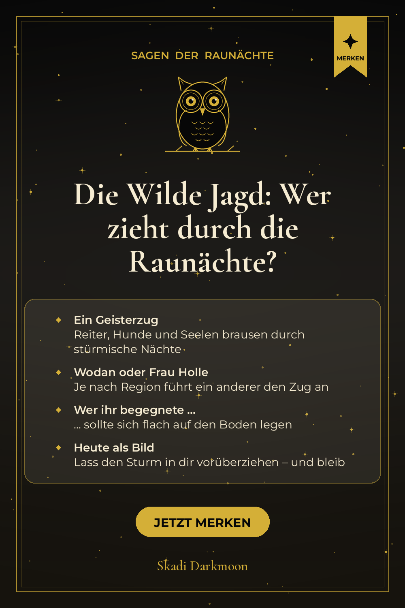

**Titel:** Die Wilde Jagd: Sage, Bedeutung & Bräuche der Raunächte

**Beschreibung:**

Wenn der Wind ums Haus heult, zieht der Sage nach die Wilde Jagd über den Himmel – angeführt von Wodan, Frau Holle oder Perchta. Viele Raunacht-Bräuche hängen mit ihr zusammen. Und heute? Kannst du sie als Bild nutzen: für alles Stürmische, das vorüberziehen darf.

**Board:** Raunächte & Yule  
**Alt-Text:** Pin im Stil des Begleitbuchs mit Titel „Die Wilde Jagd: Wer zieht durch die Raunächte?“ und Info-Liste zum Speichern  
**Link:** PDF „Yule & die Raunächte“

## 10. 2026-12-04 · 20:15 Uhr · Info
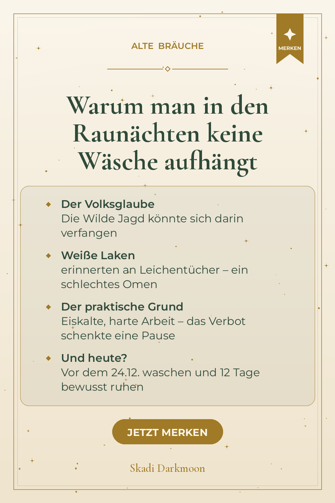

**Titel:** Keine Wäsche in den Raunächten: Bedeutung des Waschverbots

**Beschreibung:**

Das bekannteste Raunacht-Verbot: keine Wäsche waschen und aufhängen. Dahinter steckt die Sage der Wilden Jagd – und ein ganz praktischer Grund, denn Waschen war im Winter harte, eiskalte Arbeit. Heute ist es eine schöne Einladung zur Ruhe. Mit kleinen Kindern? Kein Problem – es geht um die Haltung, nicht um Perfektion.

**Board:** Raunächte & Yule  
**Alt-Text:** Pin im Stil des Begleitbuchs mit Titel „Warum man in den Raunächten keine Wäsche aufhängt“ und Info-Liste zum Speichern  
**Link:** Blogartikel Raunacht-Bräuche oder PDF „Yule & die Raunächte“

## 11. 2026-12-05 · 20:15 Uhr · Info
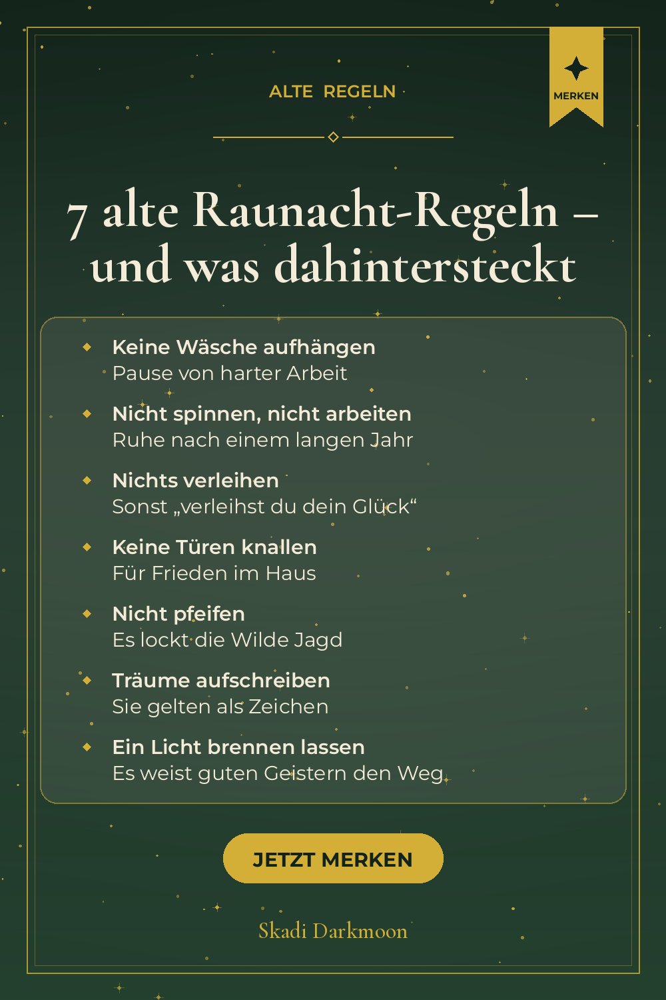

**Titel:** Raunächte Regeln & Verbote: 7 alte Bräuche und ihre Bedeutung

**Beschreibung:**

Keine Wäsche, nicht spinnen, nichts verleihen, keine Türen knallen: Die Raunächte waren voller Regeln. Viele hatten eine spirituelle und eine ganz praktische Seite – Schutz vor Kälte, Unfällen, Streit und Erschöpfung. Speichere dir die Übersicht und such dir aus, welcher Brauch zu dir passt.

**Board:** Raunächte & Yule  
**Alt-Text:** Pin im Stil des Begleitbuchs mit Titel „7 alte Raunacht-Regeln – und was dahintersteckt“ und Info-Liste zum Speichern  
**Link:** PDF „Yule & die Raunächte“

## 12. 2026-12-06 · 20:15 Uhr · Info

**Titel:** Raunächte vorbereiten: Checkliste vor dem 24. Dezember

**Beschreibung:**

Wer gut vorbereitet in die Raunächte geht, kann sich ganz auf die Stille einlassen. Diese Checkliste hilft dir: aufräumen, Wäsche waschen, Ausgeliehenes zurückgeben, entrümpeln, 13 Wünsche aufschreiben, Kerzen und Räucherwerk bereitlegen – und den Kalender leeren. Pin speichern und abhaken!

**Board:** Raunächte & Yule  
**Alt-Text:** Pin im Stil des Begleitbuchs mit Titel „Deine Checkliste vor dem 24. Dezember“ und Info-Liste zum Speichern  
**Link:** PDF „Yule & die Raunächte“

## 13. 2026-12-07 · 20:15 Uhr · Produkt
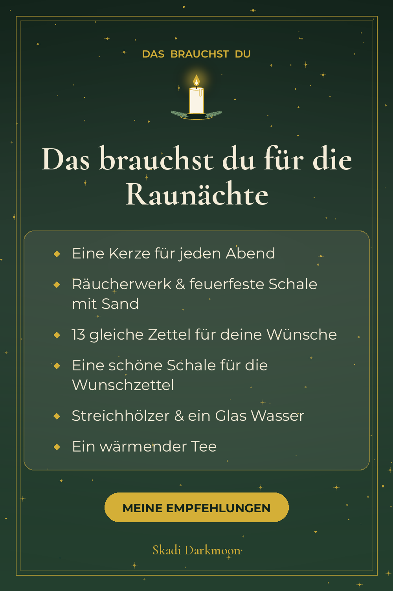

**Titel:** Raunächte Zubehör: Was du für die Rauhnächte brauchst

**Beschreibung:**

Für die Raunächte brauchst du nicht viel: Kerzen, Räucherwerk mit feuerfester Schale und Sand, 13 Zettel für das Wünsche-Ritual, eine Schale, Streichhölzer und einen guten Tee. Hier findest du meine Empfehlungen für gemütliche Ritual-Abende zwischen den Jahren.

*Werbung: Affiliate-Link. Beim Kauf erhalte ich eine kleine Provision – für dich ändert sich nichts am Preis.

**Board:** Mystische Fundstücke  
**Alt-Text:** Pin im Stil des Begleitbuchs mit Titel „Das brauchst du für die Raunächte“ und Info-Liste zum Speichern  
**Link:** Amazon-Liste Raunacht-Zubehör

## 14. 2026-12-08 · 20:15 Uhr · Ritual
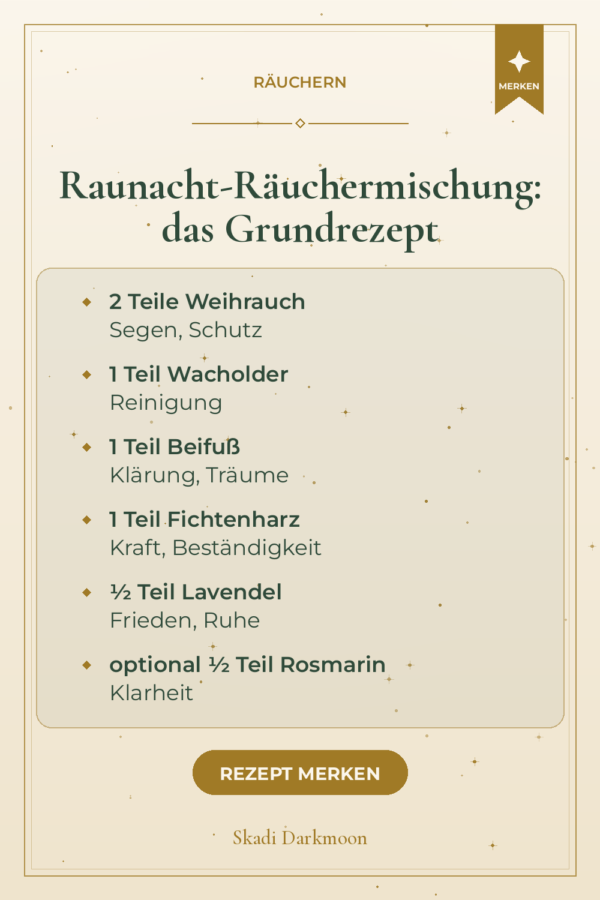

**Titel:** Räuchermischung für die Rauhnächte selber machen – Grundrezept

**Beschreibung:**

Stell dir deine eigene Raunacht-Räuchermischung zusammen: Weihrauch, Wacholder, Beifuß, Fichtenharz, Lavendel und etwas Rosmarin. Harze im Mörser zerstoßen, alles mischen und deine Intention hineinsprechen. Wichtig: nie unbeaufsichtigt räuchern, gut lüften und bei Asthma, Schwangerschaft, Babys und Haustieren auf Rauch verzichten.

**Board:** Rituale & Mondmagie  
**Alt-Text:** Pin im Stil des Begleitbuchs mit Titel „Raunacht-Räuchermischung: das Grundrezept“ und Info-Liste zum Speichern  
**Link:** PDF „Yule & die Raunächte“

## 15. 2026-12-09 · 20:15 Uhr · Ritual
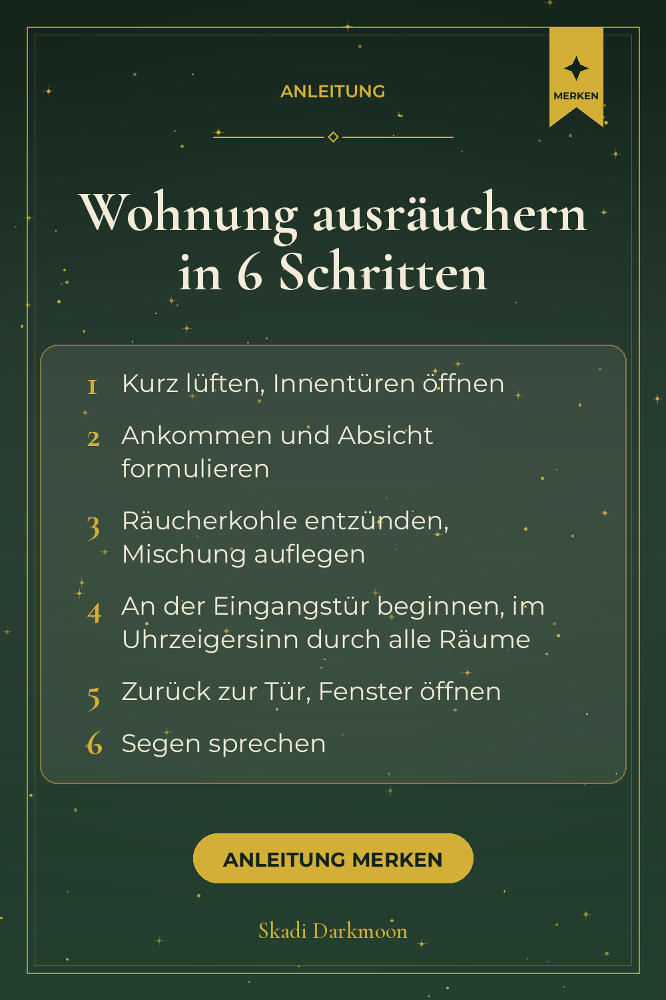

**Titel:** Wohnung ausräuchern in den Raunächten – Anleitung in 6 Schritten

**Beschreibung:**

So räucherst du Haus oder Wohnung in den Raunächten aus: lüften, Absicht formulieren, Räucherwerk auflegen, im Uhrzeigersinn durch alle Räume gehen, Fenster öffnen und mit einem Segen abschließen. Besonders in den vier großen Raunächten ein schöner Brauch. Sicherheit geht vor: nie unbeaufsichtigt, feuerfeste Unterlage, Rauchmelder beachten.

**Board:** Rituale & Mondmagie  
**Alt-Text:** Pin im Stil des Begleitbuchs mit Titel „Wohnung ausräuchern in 6 Schritten“ und Info-Liste zum Speichern  
**Link:** PDF „Yule & die Raunächte“

## 16. 2026-12-10 · 20:15 Uhr · Selfcare
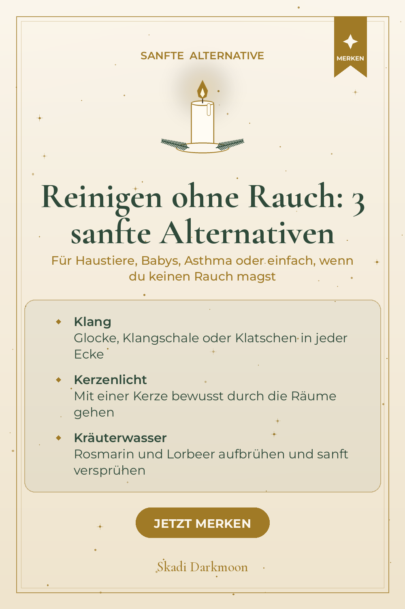

**Titel:** Räuchern ohne Rauch: sanfte Alternativen für Haustiere & Babys

**Beschreibung:**

Räuchern ist der zentrale Brauch der Raunächte – aber nicht für jeden geeignet. Bei Asthma, in der Schwangerschaft, mit Babys und Haustieren (besonders Vögeln und Katzen) kannst du stattdessen mit Klang, Kerzenlicht oder einem Kräuterwasser aus Rosmarin und Lorbeer reinigen. Genauso wirkungsvoll als Ritual.

**Board:** Rituale & Mondmagie  
**Alt-Text:** Pin im Stil des Begleitbuchs mit Titel „Reinigen ohne Rauch: 3 sanfte Alternativen“ und Info-Liste zum Speichern  
**Link:** PDF „Yule & die Raunächte“

## 17. 2026-12-11 · 20:15 Uhr · Ritual
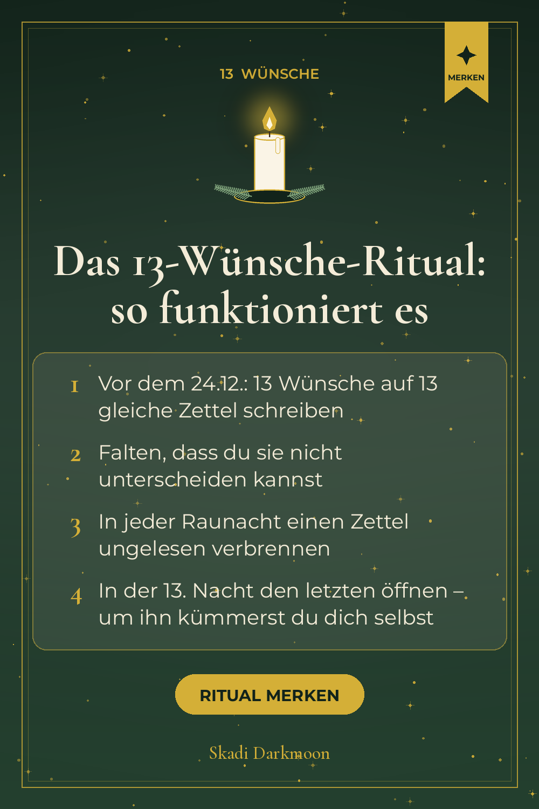

**Titel:** 13 Wünsche Ritual Raunächte: Anleitung Schritt für Schritt

**Beschreibung:**

Zwölf Wünsche gibst du ab, einen behältst du: So funktioniert das 13-Wünsche-Ritual der Raunächte. Vor dem 24. Dezember schreibst du 13 Wünsche auf, verbrennst in jeder Raunacht einen Zettel ungelesen und öffnest in der 13. Nacht den letzten. Im Begleitbuch findest du Wunschkärtchen zum Ausschneiden.

**Board:** Rituale & Mondmagie  
**Alt-Text:** Pin im Stil des Begleitbuchs mit Titel „Das 13-Wünsche-Ritual: so funktioniert es“ und Info-Liste zum Speichern  
**Link:** PDF „Yule & die Raunächte“

## 18. 2026-12-12 · 20:15 Uhr · Ritual
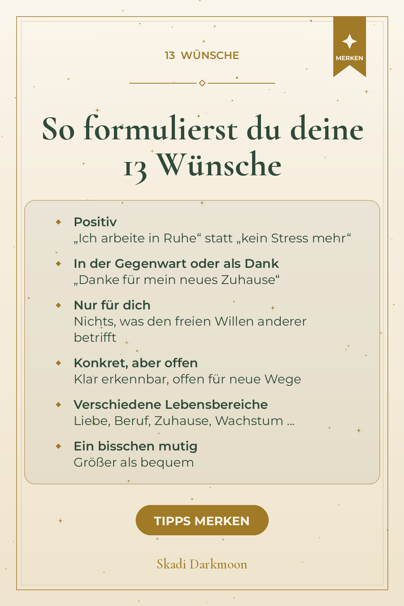

**Titel:** 13 Wünsche formulieren: 6 Regeln mit Beispielen für die Raunächte

**Beschreibung:**

Weil du nicht weißt, welcher Wunsch übrig bleibt, sollten alle 13 so formuliert sein, dass du sie selbst angehen kannst: positiv, in der Gegenwart, nur für dich, konkret und doch offen, aus verschiedenen Lebensbereichen – und ruhig ein bisschen mutig. Mit Beispielen zum Speichern.

**Board:** Rituale & Mondmagie  
**Alt-Text:** Pin im Stil des Begleitbuchs mit Titel „So formulierst du deine 13 Wünsche“ und Info-Liste zum Speichern  
**Link:** PDF „Yule & die Raunächte“

## 19. 2026-12-13 · 20:15 Uhr · Selfcare

**Titel:** Wünsche richtig formulieren: Wünsch dir das Gefühl, nicht das Ding

**Beschreibung:**

Frag dich bei jedem deiner 13 Wünsche: Welches Gefühl erhoffe ich mir davon? Manchmal ist es klüger, das Gefühl zu wünschen als das Ding. So lässt du dem Leben mehr Wege offen. Ein kleiner Impuls für dein 13-Wünsche-Ritual in den Raunächten.

**Board:** Rituale & Mondmagie  
**Alt-Text:** Tannengrüne Grafik mit goldener Sonne, Text: Wünsch dir das Gefühl – nicht das Ding  
**Link:** PDF „Yule & die Raunächte“

## 20. 2026-12-14 · 20:15 Uhr · Ritual
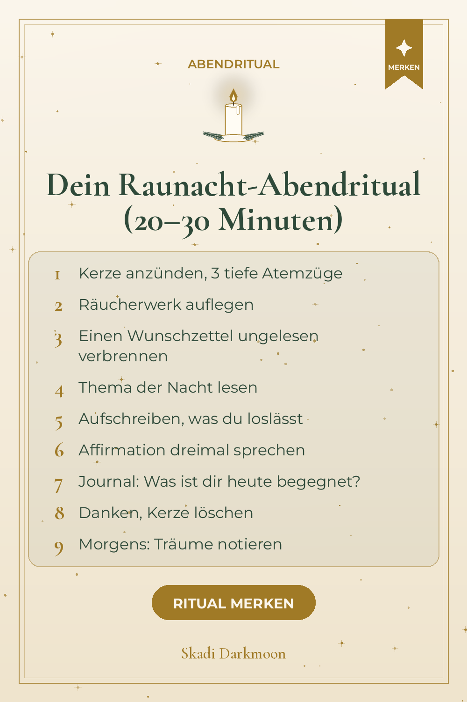

**Titel:** Raunacht Ritual für jeden Abend: Ablauf in 9 Schritten

**Beschreibung:**

Für jede der 13 Raunächte kannst du dem gleichen einfachen Ablauf folgen: Kerze, Räuchern, Wunschzettel verbrennen, Thema der Nacht, Loslassen, Affirmation, Journal – und am Morgen die Träume notieren. Keine Zeit? Dann nur Kerze, Wunsch und drei Sätze. Die Raunächte sind kein Pflichtprogramm, sondern ein Geschenk an dich.

**Board:** Rituale & Mondmagie  
**Alt-Text:** Pin im Stil des Begleitbuchs mit Titel „Dein Raunacht-Abendritual (20–30 Minuten)“ und Info-Liste zum Speichern  
**Link:** PDF „Yule & die Raunächte“

## 21. 2026-12-15 · 20:15 Uhr · Info
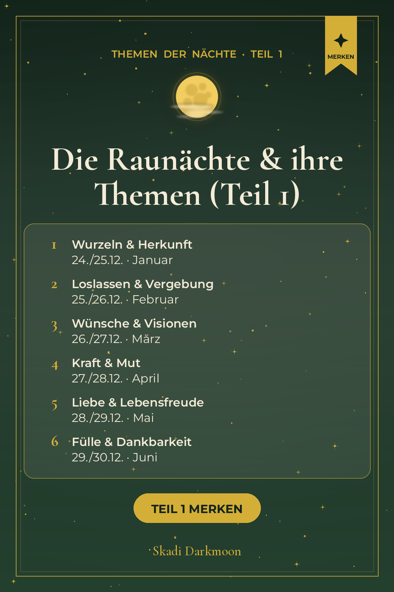

**Titel:** Raunächte Themen: Bedeutung jeder Nacht (1.–6. Raunacht)

**Beschreibung:**

Jede Raunacht hat ihr eigenes Thema und steht für einen Monat des neuen Jahres: Wurzeln & Herkunft (Januar), Loslassen & Vergebung (Februar), Wünsche & Visionen (März), Kraft & Mut (April), Liebe & Lebensfreude (Mai), Fülle & Dankbarkeit (Juni). Im Begleitbuch hat jede Nacht ihre eigene Journalseite.

**Board:** Raunächte & Yule  
**Alt-Text:** Pin im Stil des Begleitbuchs mit Titel „Die Raunächte & ihre Themen (Teil 1)“ und Info-Liste zum Speichern  
**Link:** PDF „Yule & die Raunächte“

## 22. 2026-12-16 · 20:15 Uhr · Info
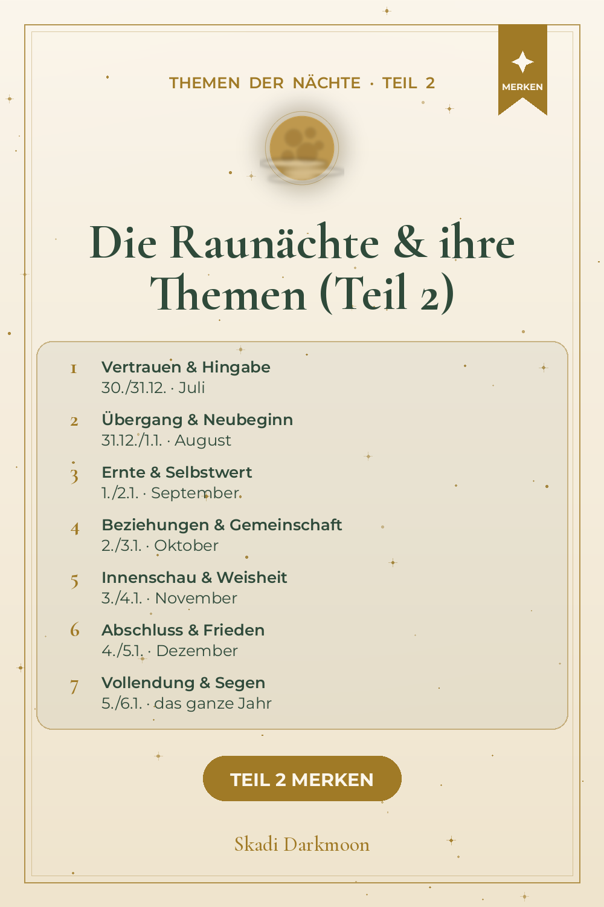

**Titel:** Raunächte Themen: Bedeutung jeder Nacht (7.–13. Raunacht)

**Beschreibung:**

Teil 2 deiner Raunacht-Übersicht: Vertrauen & Hingabe (Juli), Übergang & Neubeginn (August), Ernte & Selbstwert (September), Beziehungen & Gemeinschaft (Oktober), Innenschau & Weisheit (November), Abschluss & Frieden (Dezember) und die 13. Nacht der Vollendung, die für das ganze Jahr steht.

**Board:** Raunächte & Yule  
**Alt-Text:** Pin im Stil des Begleitbuchs mit Titel „Die Raunächte & ihre Themen (Teil 2)“ und Info-Liste zum Speichern  
**Link:** PDF „Yule & die Raunächte“

## 23. 2026-12-17 · 20:15 Uhr · Info
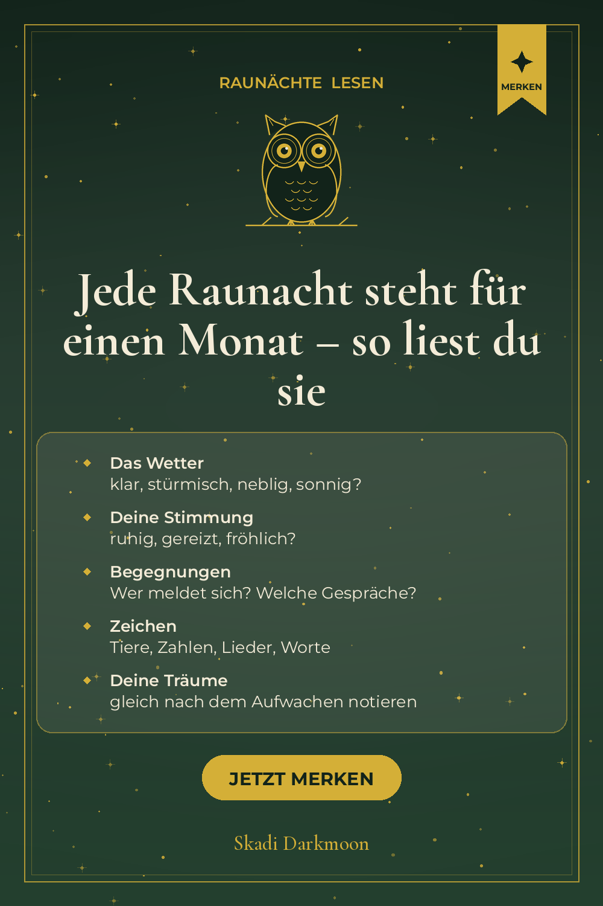

**Titel:** Raunächte deuten: So liest du jede Nacht für deinen Monat

**Beschreibung:**

Nach altem Glauben spiegelt jede Raunacht einen Monat des neuen Jahres. Achte auf Wetter, Stimmung, Begegnungen, Zeichen und Träume – nicht als feste Vorhersage, sondern als Spiegel: Was beschäftigt mich, und was will ich in diesem Bereich? Wenn der Monat kommt, kannst du vergleichen.

**Board:** Raunächte & Yule  
**Alt-Text:** Pin im Stil des Begleitbuchs mit Titel „Jede Raunacht steht für einen Monat – so liest du sie“ und Info-Liste zum Speichern  
**Link:** PDF „Yule & die Raunächte“

## 24. 2026-12-18 · 20:15 Uhr · Ritual
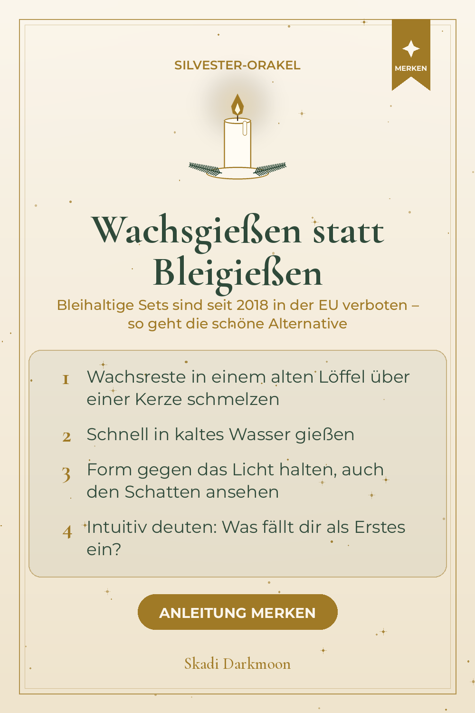

**Titel:** Wachsgießen an Silvester: Anleitung als Alternative zum Bleigießen

**Beschreibung:**

Bleigießen ist out – seit 2018 dürfen bleihaltige Sets in der EU nicht mehr verkauft werden. Die schöne, sichere Alternative: Wachsgießen mit den Resten deiner Ritualkerzen. Schmelzen, ins kalte Wasser gießen, gegen das Licht halten und intuitiv deuten. Perfekt für die Silvester-Raunacht.

**Board:** Rituale & Mondmagie  
**Alt-Text:** Pin im Stil des Begleitbuchs mit Titel „Wachsgießen statt Bleigießen“ und Info-Liste zum Speichern  
**Link:** PDF „Yule & die Raunächte“

## 25. 2026-12-19 · 20:15 Uhr · Info
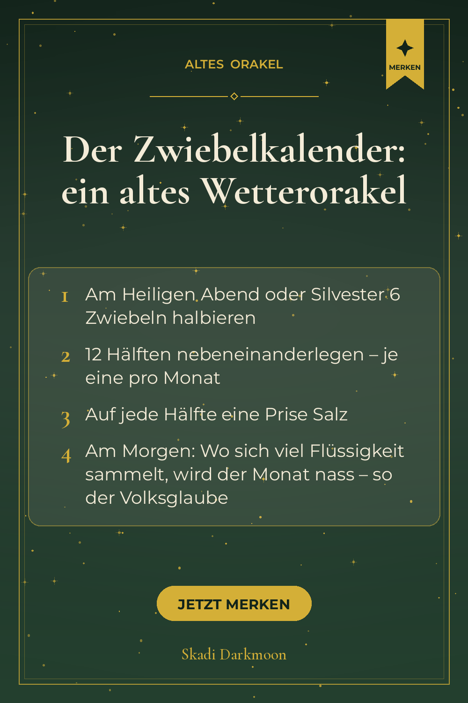

**Titel:** Zwiebelkalender: Das alte Raunacht-Wetterorakel zum Ausprobieren

**Beschreibung:**

Ein traditionelles Wetterorakel für die Raunächte: Zwölf Zwiebelhälften mit Salz stehen für die zwölf Monate. Wo sich bis zum Morgen viel Flüssigkeit sammelt, wird der Monat dem Volksglauben nach besonders nass. Ein charmanter Brauch zum Ausprobieren mit der Familie.

**Board:** Raunächte & Yule  
**Alt-Text:** Pin im Stil des Begleitbuchs mit Titel „Der Zwiebelkalender: ein altes Wetterorakel“ und Info-Liste zum Speichern  
**Link:** Blogartikel Raunacht-Orakel oder PDF „Yule & die Raunächte“

## 26. 2026-12-20 · 20:15 Uhr · Ritual
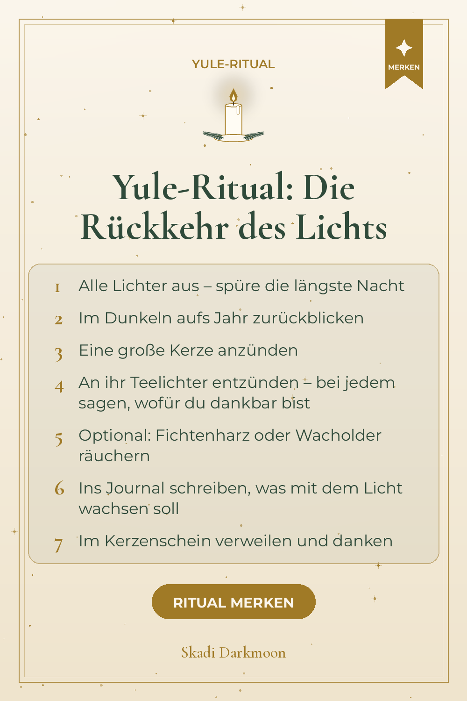

**Titel:** Yule Ritual zur Wintersonnenwende: Die Rückkehr des Lichts

**Beschreibung:**

Ein Ritual für den Abend der Wintersonnenwende (30–45 Minuten): Im Dunkeln aufs Jahr zurückblicken, eine große Kerze entzünden und mit jedem Teelicht aussprechen, wofür du dankbar bist – bis der Raum hell wird. Dann ein Wort für das neue Licht in dein Journal. Pin speichern für den 21. Dezember.

**Board:** Rituale & Mondmagie  
**Alt-Text:** Pin im Stil des Begleitbuchs mit Titel „Yule-Ritual: Die Rückkehr des Lichts“ und Info-Liste zum Speichern  
**Link:** PDF „Yule & die Raunächte“

## 27. 2026-12-21 · 20:15 Uhr · Info
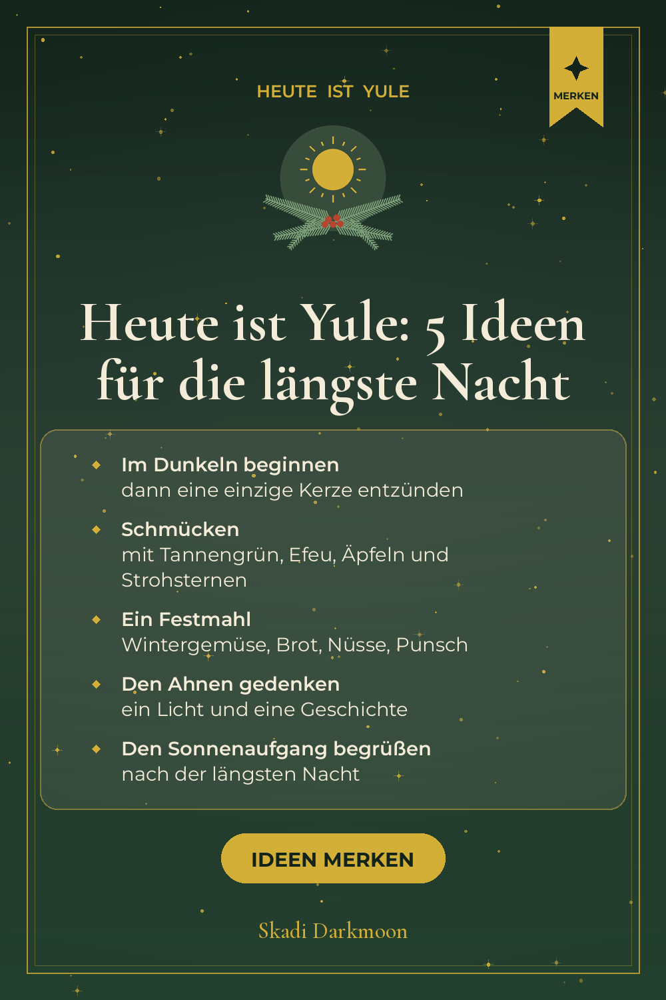

**Titel:** Yule feiern: 5 Ideen für die Wintersonnenwende am 21. Dezember

**Beschreibung:**

Es gibt keine vorgeschriebene Art, Yule zu feiern. Ein paar Ideen für deinen Abend: im Dunkeln beginnen und eine einzige Kerze entzünden, mit Immergrün schmücken, ein Festmahl mit Wintergemüse und Punsch, der Ahnen gedenken – und den ersten Sonnenaufgang nach der längsten Nacht begrüßen.

**Board:** Raunächte & Yule  
**Alt-Text:** Pin im Stil des Begleitbuchs mit Titel „Heute ist Yule: 5 Ideen für die längste Nacht“ und Info-Liste zum Speichern  
**Link:** PDF „Yule & die Raunächte“

## 28. 2026-12-22 · 20:15 Uhr · Selfcare
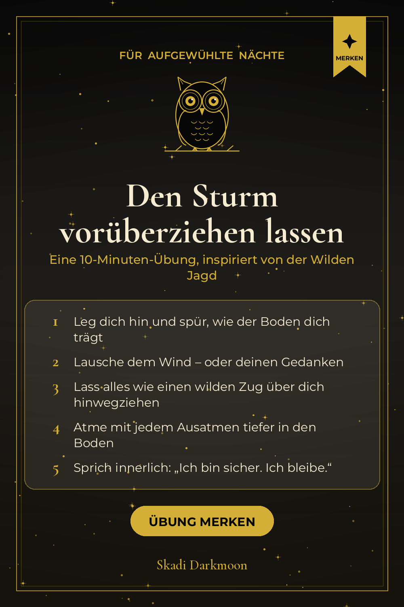

**Titel:** Übung gegen innere Unruhe: Den Sturm vorüberziehen lassen

**Beschreibung:**

Für eine stürmische Raunacht oder eine aufgewühlte Stunde: Statt dich von Gedanken mitreißen zu lassen, legst du dich hin, erdest dich und lässt alles wie die Wilde Jagd über dich hinwegziehen. Eine sanfte 10-Minuten-Übung für mehr Ruhe zwischen den Jahren.

**Board:** Rituale & Mondmagie  
**Alt-Text:** Pin im Stil des Begleitbuchs mit Titel „Den Sturm vorüberziehen lassen“ und Info-Liste zum Speichern  
**Link:** PDF „Yule & die Raunächte“

## 29. 2026-12-23 · 20:15 Uhr · Ritual
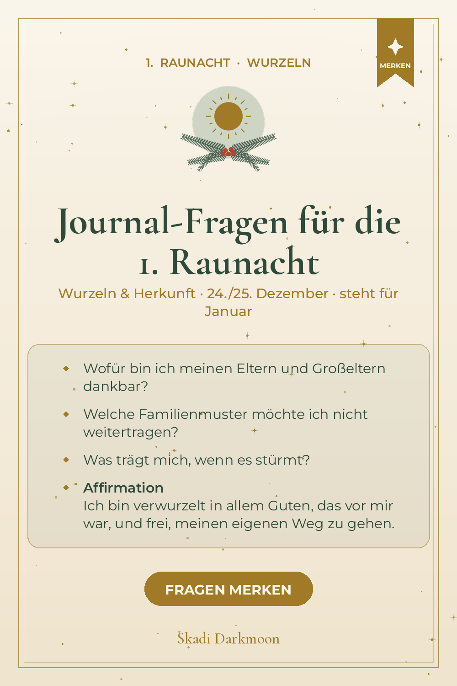

**Titel:** 1. Raunacht: Journal-Fragen & Affirmation (Wurzeln & Herkunft)

**Beschreibung:**

Die erste Raunacht ist die Heilige Nacht. Sie steht für den Januar und für das, was uns trägt: Herkunft, Familie, Ahnen, Werte. Mit diesen drei Journal-Fragen und einer Affirmation beginnst du deine Raunachtszeit. Im Begleitbuch findest du solche Seiten für alle 13 Nächte – mit Platz für deine Träume.

**Board:** Spirituelle Downloads & PDFs  
**Alt-Text:** Pin im Stil des Begleitbuchs mit Titel „Journal-Fragen für die 1. Raunacht“ und Info-Liste zum Speichern  
**Link:** PDF „Yule & die Raunächte“

## 30. 2026-12-24 · 20:15 Uhr · PDF
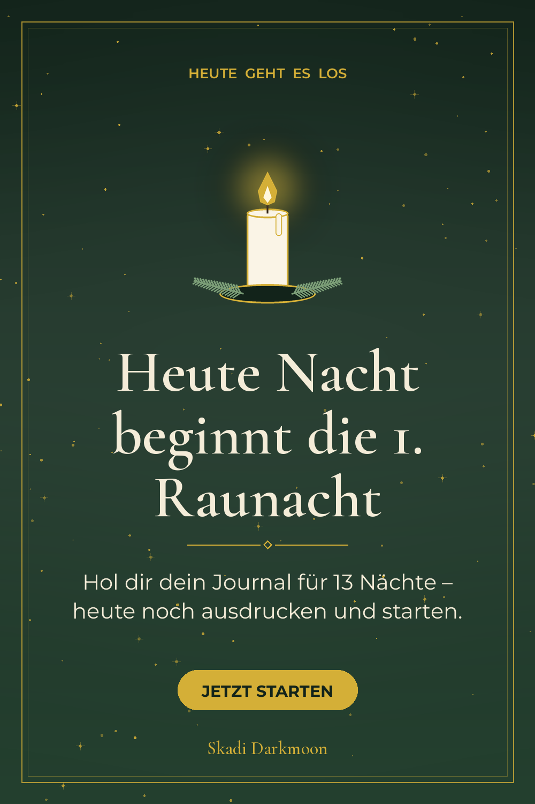

**Titel:** Raunächte starten heute: Journal für 13 Nächte zum Sofort-Ausdrucken

**Beschreibung:**

Heute Nacht, vom 24. auf den 25. Dezember, beginnt die erste Raunacht. Mit „Yule & die Raunächte“ hast du alles für die Zeit zwischen den Jahren: das 13-Wünsche-Ritual mit Wunschkärtchen, ein Abendritual und für jede der 13 Nächte Thema, Monat, Loslass-Impuls, Affirmation und Journalseite. Als PDF sofort zum Ausdrucken.

**Board:** Spirituelle Downloads & PDFs  
**Alt-Text:** Tannengrüne Grafik mit brennender Kerze, Text: Heute Nacht beginnt die 1. Raunacht  
**Link:** PDF „Yule & die Raunächte“

---
_Kartenlegen dient der Selbstreflexion und Unterhaltung und ersetzt keine ärztliche, psychologische oder rechtliche Beratung._
